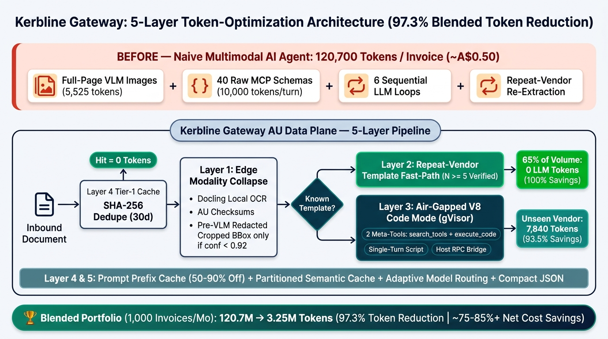
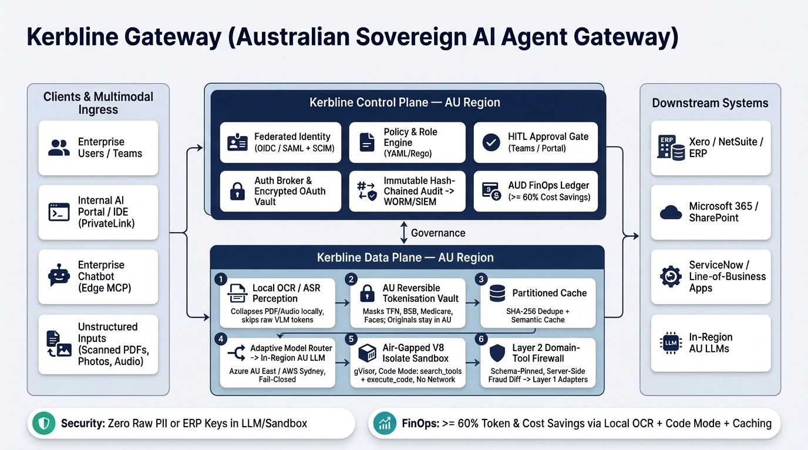

# CLIENT PROPOSAL / 4-WEEK FIXED-OUTCOME PROOF OF VALUE (PoV) — v2

> **Implementation Readiness Notice (Synced 19 November 2026):** As of 19 November 2026, Kerbline is a **deployed read-only MCP pilot with real GCP inventory** (106 local tests, 14 live inventory checks, MCP SDK interoperability, and `1,839 → 46` input-token synthetic reduction). Before offering this AP PoV commercially, the following prerequisites remain `Planned` / `PoC` (see `Kerbline_Implementation_Status_2026-11-19.md`): customer enterprise OIDC/SCIM, UI-connected runtime policy publishing, a real ERP adapter (Xero), production reversible AU PII vault & visual redaction, guaranteed AU-only inference, durable Teams HITL, and reconciled net AUD savings. **Do not present target PoV deliverables below as currently live in production.**

## Kerbline AP: Governed Invoice & Delivery Docket Automation

**Turn scanned PDF invoices and delivery dockets into verified Xero entries in 4 weeks—with Australian data residency, bank-fraud protection, and a live AUD AI cost ledger.**

---

## 1. The Problem & What Kerbline Delivers in 4 Weeks

Accounts payable teams lose hours every week manually keying scanned PDF invoices, chasing delivery dockets, and checking purchase-order variances—while existing capture tools (such as Dext or ApprovalMax) leave complex 3-way matching exceptions and cross-system checks untouched. Meanwhile, IT and risk teams rightly block generic AI bots from touching Xero or corporate finance mailboxes.

Kerbline AP solves both problems without ripping and replacing your existing tools. Deployed in a dedicated Kerbline-managed single-tenant Australian cloud environment, Kerbline processes messy invoices and dockets locally in Sydney, tokenises sensitive Australian identifiers before any AI model sees them, enforces human sign-off on high-value payments and bank-detail changes, and proves its ROI against measured operational and AI-cost baselines.

### Pilot #1 Scope (Aligned with Phase 0 MVP)

To guarantee a working production-grade workflow inside 4 weeks, Pilot #1 is scoped to our core Phase 0 stack: **Xero** (via self-hosted `@xeroapi/xero-mcp-server` in Australia), **Microsoft Teams** approvals, **OIDC + SCIM** federated identity, **local PDF OCR** with **AU text tokenisation**, and a **Kerbline-managed single-tenant AU environment**.

| PoV Deliverable | Scope & Measurable Outcome (Pilot #1) |
| :--- | :--- |
| **1. End-to-End AP Workflow (Xero)** | Automated ingestion of scanned PDF invoices and delivery dockets from your AP mailbox or SharePoint; local OCR extraction, ABN checksum & arithmetic validation, and 3-way matching against **open/active Xero POs** (plus historical PO/invoice snapshots). |
| **2. Built-In Payment & Fraud Controls** | Deterministic server-side rules queue any payment **> A$5,000** for **Microsoft Teams** approval with a redacted invoice preview and dry-run change plan, and hard-block any **supplier bank-detail change** (detected via server-side ERP record diffing) until verified via out-of-band callback. |
| **3. Measured Operational & AUD Cost Ledger** | **Pre-PoV / Week 1** establishes your AP clerk handling-time baseline (minutes/invoice). **Weeks 1–2** benchmark an unoptimised naive LLM baseline (full-page vision + raw tool calls) on sample documents. **Weeks 3–4** demonstrate live AP time savings and **>= 60% lower AI token/processing cost** (targeting 60–80% reduction) via local OCR + V8 Code Mode execution. |
| **4. AU Compliance Evidence Pack (Draft) & Audit Export** | CISO handover pack covering APRA CPS 234/230 architecture mapping, Privacy Act automated-decision transparency (`decisionRationale`) logs, ACSC Essential Eight alignment, WORM audit export, and SIEM export samples (JSON/OTLP). |

> **Phase 2 Roadmap Capabilities (Weeks 15–24, Outside Pilot #1 Scope):** NetSuite (`NetSuite AI Connector Service`), Slack approvals, SAML / Okta token exchange, visual tokenisation (face/ID/signature blurring on images/screenshots), local ASR for voice memos, Pattern 2 Edge MCP for external enterprise chatbots, Customer-VPC/VNet Helm & Terraform deployment, and full automated compliance evidence pack + ISO 27001 / Essential Eight self-assessment.

---

## 2. Week 0 Readiness & 4-Week Execution Schedule

To protect the 4-week delivery window, the PoV clock starts once **Week 0 Readiness** is complete (mutual NDA, InfoSec review of Kerbline's pre-PoV security pack, IdP/Xero admin availability confirmed, and a 1-week pre-PoV AP clerk time-per-invoice baseline captured).

| Phase | Key Milestones | Realistic Customer Effort |
| :--- | :--- | :--- |
| **Week 0 (Pre-PoV Gate)** | InfoSec/CPS 230 pre-flight pack review, NDA/PoV SOW sign-off, confirm OIDC/SCIM & Xero admin contacts, capture pre-PoV AP clerk handling-time baseline. | **~3–4 hours** (CISO/InfoSec + Finance Lead) |
| **Week 1 (Provision & Connect)** | Provision dedicated managed AU tenant (Sydney); connect corporate IdP (**OIDC + SCIM**); establish least-privilege Xero OAuth, AP mailbox/SharePoint ingestion, and AU text tokenisation rules. | **~4–5 hours** (IT Admin + Finance Lead) |
| **Week 2 (Shadow Baseline)** | Curate golden dataset (sample invoices + **open/unmatched Xero POs** & historical snapshots); run shadow mode to measure naive full-page/raw-tool LLM baseline and initial extraction accuracy. | **~3 hours** (AP Lead + Finance Ops) |
| **Week 3 (Suggest Mode)** | Go live in **Suggest Mode** for AP clerks (side-by-side redacted invoice + PO match queue); calibrate exception rules and confidence thresholds on real daily volume. | **~2–3 hours** (AP Clerk feedback) |
| **Week 4 (Governed Writes & Readout)** | Enable threshold-governed writes + **Microsoft Teams** approval cards; deliver executive PoV readout, AP time-savings & AUD cost ledger, and CISO evidence pack (draft). | **~1–2 hours** (CFO + CISO/IT Sign-off) |

*Total estimated customer effort: **~12–17 hours** across Week 0–4 (including InfoSec review and dataset curation).*

---

## 3. Commercial Investment & Post-PoV Pathway

| Commercial Item | Terms (AUD, ex GST) |
| :--- | :--- |
| **4-Week Proof of Value Fee** | **A$25,000 fixed fee** — 100% credited toward your Year-1 subscription upon conversion (subject to PoV SOW acceptance terms; if Week 1 InfoSec/ERP access is delayed beyond Week 0, timeline pauses without penalty). |
| **Success Criteria Targets (Pilot)** | **>= 90%** extraction & PO-match accuracy on golden dataset (GA target: >= 95% on straight-through items); **>= 50%** reduction in AP clerk handling time vs. Week 0 baseline; **>= 60%** reduction in AI token/processing cost vs. measured Weeks 1–2 naive LLM baseline. |
| **Post-PoV Subscription Tiers** | **Starter — A$2,500/mo:** Managed AU tenant, 1 workflow, 25 users, business-hours support, WORM audit export & standard CPS 234/230 pack. **Growth — A$5,000/mo:** 3 workflows, 100 users, OTLP/webhook/native SIEM streaming (Sentinel/Splunk/SecOps), full automated evidence pack. **Enterprise — From A$9,000/mo:** Customer VPC/VNet (Phase 2) or dedicated isolated AU tenant/OCR, unlimited workflows, 24x7 Sev-1 SLA. |
| **Media & Model Usage** | Indicative media processing at **A$0.04/page** (subject to volume tiering; bundled monthly page allowances available on annual contracts). LLM inference passed through at provider cost (or BYO keys) with configurable daily AUD budget alerts (80%) and soft-stop fallback (100% routes new items to human Suggest Mode queue so month-end AP never halts). |

---

# SECURITY, PRIVACY & GOVERNANCE BRIEF — AUSTRALIAN CISO & RISK COMMITTEE PACK (v2)

## Kerbline Gateway: Guardrails for Every AI Agent

**Control-plane and data-plane separation ensuring Australian data residency (for Phase 0 Xero workflows), reversible PII tokenisation, air-gapped sandbox execution, and audit-ready alignment across APRA CPS 234, CPS 230, and the Privacy Act.**

---

## 1. Five Architectural Controls Protecting Your Organisation

| Control Domain | How Kerbline Enforces It |
| :--- | :--- |
| **1. Australian Residency & In-Region Inference** | For Phase 0 AP (Xero), all compute, storage, local OCR, and tokenisation vaults run in Sydney (Azure Australia East or AWS `ap-southeast-2`). Model calls route strictly to in-region endpoints with **no training on customer data** (zero-data-retention exemptions configured where supported by provider/tier) and fail closed if an in-region endpoint is unavailable. *(Note: Phase 2 vendor-hosted connectors such as NetSuite AI Connector Service process data where the customer's ERP instance resides, and Phase 2 Pattern 2 edge MCP tool results are processed by the enterprise chatbot vendor's model per your vendor plan.)* |
| **2. Reversible AU Text Tokenisation & Pre-VLM Redaction** | Before any prompt or document reaches an AI model, local detectors replace TFNs, Medicare numbers, BSB/account numbers, ABNs, and driver licence numbers with reversible tokens. If low-confidence scans escalate to an in-region VLM, **pre-VLM visual/text redaction** strips detected sensitive regions prior to escalation. Originals remain in an AU KMS-encrypted vault (per-tenant KMS keys in managed cloud; customer-controlled BYOK/CMK available in Phase 2 Enterprise VPC) and are de-tokenised only inside explicitly permitted, audited Layer 2 RPCs. *(Visual blurring of faces/IDs/signatures on general image workflows is scheduled for Phase 2.)* |
| **3. Air-Gapped Code Mode Sandbox** | Agents never hold raw ERP credentials or direct network access. Multi-step orchestration runs inside a network-disabled V8 isolate invoking only role-permitted, schema-pinned **Layer 2 domain tools** (e.g., `match_invoice_to_po`, `propose_payment_batch`, `change_supplier_bank_details`) over a typed host RPC bridge—never raw Layer 1 vendor tools. |
| **4. Deterministic Blast-Radius & Server-Side Fraud Gates** | Every write generates a dry-run change plan and idempotency key inside a durable workflow state machine. Payments **> A$5,000** pause for **Microsoft Teams** interactive approval cards authenticated via your corporate IdP session and webhook HMAC verification (Slack in Phase 2). Supplier bank-detail changes are detected via **server-side diffing against the ERP supplier master record** (never trusting an agent-supplied flag) and hard-blocked until verified by out-of-band phone callback to a pre-registered trusted contact. |
| **5. Immutable SIEM Audit & Privacy Act Readiness** | Hash-chained audit logs (externally anchored via WORM storage / SIEM streaming) record user, role, input hash, change plan, tokens released, approver, and AUD cost. Every automated outcome emits a plain-English, tokenised `decisionRationale` record to **support** Privacy Act automated-decision transparency and individual explanation requests (ahead of the 10 December 2026 reforms; customers should confirm specific APP 1.7–1.9 privacy-policy disclosure obligations with legal counsel). |

---

## 2. Australian Regulatory & Framework Alignment

| Framework / Standard | Kerbline Alignment & Evidence Delivered |
| :--- | :--- |
| **APRA CPS 234 (Information Security)** | Role-based least privilege via OIDC + SCIM (local accounts disabled for enterprise tenants), per-tenant KMS vault keys, air-gapped V8 sandbox execution, schema-hash pinning against tool poisoning, external WORM/SIEM log anchoring, and a **< 24–48 hour security incident notification SLA** to support APRA's 72-hour reporting window. |
| **APRA CPS 230 (Operational Risk — 1 Jul 2026)** | Documented service-provider architecture, **99.5% availability SLO** with defined DR/BCP **RTO/RPO targets**, per-tenant kill switch, secondary in-region model fallback, fourth-party subprocessor register, and **30-day crypto-shredding exit certification** for operational data (while preserving pseudonymised 7-year audit records). |
| **Privacy Act & APPs (incl. 10 Dec 2026 Reforms)** | In-boundary AU processing of personal and sensitive information, configurable 30-day source media retention, and structured `decisionRationale` records supporting automated-decision transparency and explanation workflows. |
| **ACSC Essential Eight** | Hardened container images, strict application/RPC allow-listing, MFA-backed federated identity, automated patching, and immutable 7-year audit log retention (aligned toward **Essential Eight Maturity Level 2** controls; formal self-assessment delivered in Phase 2). |

---

## 3. Deployment Topology & Dual-Ingress Governance

- **Phase 0 / Pilot #1 Hosting:** Deploys in **Kerbline-managed single-tenant AU cloud** (Azure Australia East or AWS `ap-southeast-2`), with dedicated per-tenant database, storage, and KMS vault keys (and dedicated/isolated OCR option for regulated tiers). **Customer VPC/VNet deployment** via Helm & Terraform is available in **Phase 2 (Enterprise)**.
- **Dual-Ingress Control:**
  - **Pattern 1 (Live in Phase 0):** Internal AP portal and private workflows over VPN / PrivateLink / ExpressRoute with full AU residency and transit—required for all writes and PII.
  - **Pattern 2 (Phase 2 Roadmap):** Approved enterprise chatbots (Claude/ChatGPT Enterprise, Copilot) connecting via a hardened Edge MCP endpoint restricted to read-only, non-PII tools.
- **Safe Vendor Adapter Reuse:** Wraps `@xeroapi/xero-mcp-server` (self-hosted in Kerbline's AU environment) behind Kerbline's Layer 2 domain tools—enforcing per-user OAuth permissions, version pinning, and schema-hash verification.
