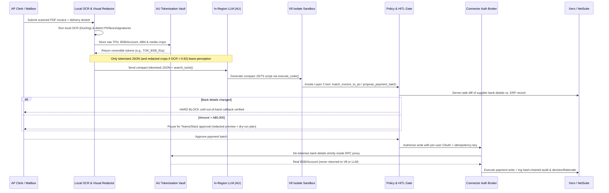

# Kerbline Gateway: Architecture, Security & Token-Savings Brief

**Guardrails for every AI agent.** Kerbline Gateway is a sovereign Australian AI agent gateway and workflow platform built for regulated and mid-market organisations (50–500 staff) that want to automate document-, image-, and audio-heavy business workflows—starting with Accounts Payable (AP)—without exposing sensitive data or losing control of AI spend.

---

## 1. What Kerbline Gateway Is & What Problem It Solves

Organisations trying to move AI agents from chat demos into production hit two immediate walls:

1. **The Security & Compliance Wall:** Risk teams and CISOs block AI agents from touching core systems (Xero, NetSuite, M365, ServiceNow) because raw PDFs, IDs, and voice recordings contain sensitive Australian PII (TFNs, Medicare numbers, BSBs, driver licences), and generic AI connectors expose broad, unfiltered ERP write APIs to prompt injection and hallucination.
2. **The Token & Cost Wall:** Sending raw multi-page scanned PDFs, images, and audio directly to frontier Vision-Language Models (VLMs), alongside dozens of verbose MCP tool schemas and multi-turn tool-calling loops, makes AI bills unpredictable and expensive.

**Kerbline Gateway solves both in one control-and-data-plane layer.** It ingests unstructured documents, images, and audio inside an Australian cloud boundary, collapses media locally using OCR/ASR, replaces sensitive Australian identifiers with reversible tokens before any LLM sees them, executes multi-step agent logic inside an air-gapped V8 sandbox against intent-based domain tools, enforces deterministic human-in-the-loop (HITL) and fraud gates on writes, and tracks every token and dollar in a live AUD FinOps ledger.

---

## 2. End-to-End Architecture

Kerbline separates **Ingress & Governance (Control Plane)** from **Media Perception, Tokenisation & Sandboxed Execution (Data Plane)**, ensuring raw PII, unredacted media, and ERP OAuth credentials never enter the LLM context or the sandbox.

### 2.1 High-Level System Architecture (Control Plane vs. Data Plane)

```mermaid
flowchart LR
    subgraph Clients["Clients & Dual Ingress"]
        P1["Pattern 1: Sovereign Internal Portal / IDE (PrivateLink / ExpressRoute)"]
        P2["Pattern 2: Enterprise Chatbot via Edge MCP (Read-Only, Non-PII Default)"]
    end

    subgraph ControlPlane["Kerbline Control Plane (AU Region)"]
        ID["Federated Identity (OIDC / SAML + SCIM)"]
        POL["Policy & Role Engine (YAML / Rego)"]
        HITL["HITL Approval Gate (Teams / Slack / Portal)"]
        AUTH["Connector Auth Broker & Encrypted Token Vault (OBO / RFC 8693 / Per-User OAuth)"]
        AUD["Immutable Audit Vault + decisionRationale (Hash-Chained -> SIEM / WORM)"]
        FIN["AUD FinOps Ledger & Budget Guardrails"]
    end

    subgraph DataPlane["Kerbline Data Plane (AU Region)"]
        OCR["Modality Perception (Local OCR / ASR / Frame Sampler)"]
        VAULT["AU Text & Visual Tokenisation Vault (Originals Stay in AU)"]
        CACHE["Partitioned Cache (SHA-256 Dedupe + Tenant/Role/Scope Vector Cache)"]
        ROUTER["Adaptive Model Router (In-Region LLM / VLM Tiering)"]
        V8["Air-Gapped V8 Isolate Sandbox (gVisor, No Net, 64 MB RAM, 5 s CPU / 30 s RPC)"]
        L2["Layer 2: Kerbline Domain Tools (Intent-Based, Schema-Pinned)"]
        L1["Layer 1: System Adapters (Official Vendor MCP / Direct API)"]
    end

    subgraph Systems["Downstream Systems"]
        ERP["Xero / NetSuite / Legacy ERP"]
        M365["Microsoft 365 / SharePoint"]
        LLM["In-Region Models (Azure OpenAI AU East / AWS Bedrock Sydney)"]
    end

    P1 --> ID
    P2 --> ID
    ID --> POL
    POL --> OCR
    OCR --> VAULT
    VAULT --> CACHE
    CACHE --> ROUTER
    ROUTER <--> LLM
    ROUTER --> V8
    V8 --> L2
    L2 --> HITL
    HITL --> AUTH
    L2 --> L1
    AUTH --> L1
    L1 --> ERP
    L1 --> M365
    V8 --> AUD
    L2 --> AUD
    ROUTER --> FIN
```

### 2.2 End-to-End Execution & Security Sequence (AP Invoice Workflow)

---

## 3. Why Kerbline Is Unique from a Security Standpoint

Most AI gateways only proxy LLM HTTP traffic or wrap raw vendor APIs. Kerbline enforces five interlocking architectural boundaries designed specifically for Australian regulated and mid-market enterprises:

1. **Reversible AU Text & Visual Tokenisation Vault:**
   - Before any prompt reaches an LLM, local detectors identify Australian-specific identifiers—TFNs (with checksum), Medicare numbers, BSB + account numbers, ABNs/ACNs, driver licences, passports—plus visual regions (faces, ID cards, signatures).
   - Originals remain encrypted inside an Australian vault. The model only reasons over reversible placeholders.
   - **Strict De-Tokenisation Boundary:** Only explicitly allow-listed RPCs (`detokeniseOnlyFor`, such as payment execution or DVS identity verification) can de-tokenise values inside the outbound RPC proxy—and sensitive fields in RPC responses are re-tokenised before returning to the sandbox or model.
2. **Layer 2 Domain-Tool Firewall (Never Raw ERP APIs):**
   - Agents never see raw Layer 1 vendor MCP tools (e.g., arbitrary Xero/NetSuite CRUD endpoints). Instead, `search_tools()` exposes only role-filtered, intent-based **Layer 2 Domain Tools** (such as `match_invoice_to_po`, `propose_payment_batch`, and `change_supplier_bank_details`).
   - Upstream vendor MCP schemas are version-pinned and SHA-256 hashed; any unexpected schema mutation blocks execution (`block-on-change`) to stop tool-poisoning and supply-chain drift.
3. **Air-Gapped V8 Isolate Execution ("Code Mode"):**
   - Instead of letting an LLM loop through dozens of sequential tool calls, Kerbline executes agent-generated orchestration scripts inside a V8 / QuickJS isolate (hardened inside gVisor/Firecracker) with **no network access, no filesystem, no environment variables**, a **64 MB memory cap**, a **5-second CPU timeout**, and a **30-second wall-clock RPC timeout**.
   - Generated code is statically checked against the user's role-based RPC allow-list before execution, and ERP OAuth/OBO tokens never enter the sandbox or model context.
4. **Deterministic, Server-Side Fraud & Blast-Radius Gates:**
   - Every write generates a **dry-run change plan** first and executes with an **idempotency key** and defined compensating actions.
   - **Bank-Detail Fraud Prevention:** Supplier bank-detail changes are detected via server-side diffing against the authoritative ERP record (never trusting self-reported LLM flags) and hard-blocked until verified via out-of-band phone callback. High-value payments (e.g., `> A$5,000`) pause for Teams/Slack approval with a redacted media preview.
5. **Australian Residency, Tenant Isolation & Immutable Auditability:**
   - Inference routes strictly to in-region endpoints (Azure Australia East / AWS Sydney) and **fails closed** if unavailable—never silently falling back to US/global endpoints.
   - Every action emits a hash-chained audit record (user, role, input hash, generated code, change plan, tokens released, approver, model, and AUD cost) plus a plain-English `decisionRationale` record supporting Privacy Act transparency and APRA CPS 234/230 evidence packs.

---

## 4. How Kerbline Achieves >= 60% Token & AI Cost Savings

Generic agentic workflows fail financially on multimodal documents because they send full-page images to frontier VLMs and dump massive MCP tool schemas into multi-turn reasoning loops. Kerbline's FinOps engine targets **50–80% (typically >= 60%) lower AI processing cost** against a measured naive baseline across four compounding layers:

| Optimisation Layer | Naive Baseline (Unoptimised) | Kerbline Architecture | Quantified Token / Cost Impact |
| :--- | :--- | :--- | :--- |
| **1. Edge Modality Collapse (Local OCR/ASR)** | Full-page PDF images (~1,000–2,000+ vision tokens/page) or raw audio sent directly to a frontier VLM. | Local Docling OCR / faster-whisper ASR converts media to compact structured JSON in AU. Cropped regions escalate to a VLM **only when OCR confidence < 0.92**. | **~70–90% reduction** in media input tokens (replaced by low-cost local/managed OCR at ~A$0.04/page). |
| **2. Code Mode (`search_tools` + `execute_code`)** | 30–100+ raw MCP tool schemas loaded into every prompt + 5–15 sequential LLM turns for pagination, joins, and retries. | Only **2 meta-tools** (`search_tools`, `execute_code`) are exposed; one V8 script chains extraction, ABN/math validation, and ERP lookups in a single turn. | **~32–81% reduction** in orchestration & schema tokens (aligned with Cloudflare Code Mode benchmarks). |
| **3. SHA-256 Dedupe & Partitioned Semantic Cache** | Duplicate invoices, re-forwarded PDFs, and repeated policy lookups re-processed from scratch on every run. | Exact SHA-256 document deduplication + vector cache **strictly partitioned by `tenant + role + dataScope`** (reference/exact-duplicate docs only; never live balances). | **~100% token elimination** on repeat/duplicate documents and static policy queries. |
| **4. Adaptive Tiered Routing & Prefix Caching** | Frontier model (e.g., Claude Sonnet/Opus or GPT-4o class) used for every standard invoice and prompt prefix re-billed at full rate. | Static instructions are version-stamped for provider **prompt prefix caching**; compact models handle standard docs while frontier VLMs trigger only on low-confidence/handwriting; rolling compaction caps history at `<= 1.5k` tokens. | **~40–65% lower blended cost/token** on routine straight-through documents, with hard per-run (`12k` token) and daily AUD budget caps. |

### Illustrative Per-Invoice Comparison (5-Page Scanned PDF + 3-Way PO Match)
- **Naive Agentic Baseline:** 5 full-page images (~7,500 vision tokens) + 40 raw ERP tool schemas (~8,000 tokens) across 6 multi-turn tool calls = **~45,000–60,000 total tokens** on a frontier VLM.
- **Kerbline Gateway:** Local OCR (~A$0.20 media fee, 0 VLM tokens on clean text) + 2 meta-tools + 1 Code Mode script + compact model = **~3,500–6,000 tokens** (with prefix caching).
- **Net Result:** **~80–90% token reduction** and **>= 60% net AUD cost reduction** (even after accounting for local OCR/GPU compute), verified live in Weeks 1–4 of every Proof of Value via the shadow-baseline AUD ledger.
