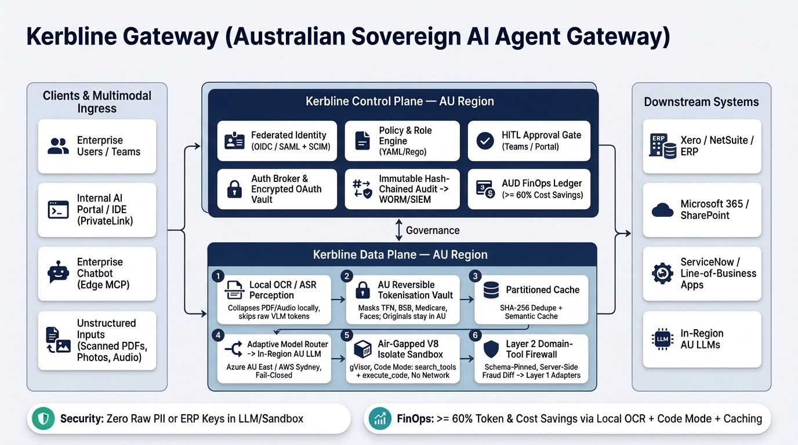
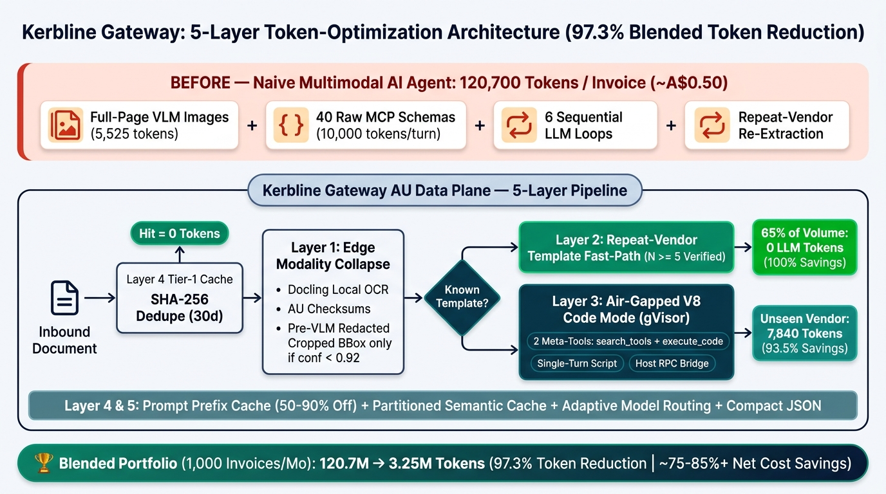

# Kerbline Gateway v4.4 — Detailed Layer-by-Layer Architecture Design

> **Target Architecture Notice (Synced 19 November 2026):** This document defines Kerbline's target v4.4 architecture. For the current verified pilot status (`Deployed` read-only MCP pilot with real GCP inventory vs. `Local` / `PoC` / `Planned` / `Disabled`), see `Kerbline_Implementation_Status_2026-11-19.md`.

**Document Purpose:** Engineering and technical architecture reference for **Kerbline Gateway v4.4**, specifying every component across the **Control Plane (`[C1]–[C5]`)**, **Data / Execution Plane (`[D1]–[D8]`)**, **Security & Tokenisation Boundary**, and **5-Layer Token-Optimization Stack**—including inputs, outputs, deterministic rules, failure/fallback modes, and operational SLAs.

---

## 1. Architectural Principles & Plane Separation

Kerbline Gateway enforces a strict separation between:
1. **Control Plane (`[C1]–[C5]`):** Stateless management, identity/policy compilation, schema registry, durable HITL state orchestration, and tamper-evident audit/FinOps aggregation.
2. **Data / Execution Plane (`[D1]–[D8]`):** Latency-sensitive ingress, asynchronous media ingestion, isolated GPU/managed perception, reversible AU tokenisation, air-gapped V8 sandbox execution, and in-region model routing.

**Global Non-Functional Targets (SLOs & Continuity):**
- **Availability SLO:** `99.5%` gateway availability (`RTO <= 4 hours`, `RPO <= 15 minutes`, multi-AZ AU deployment + encrypted cross-AU-region backups).
- **Latency SLOs:** `p95` fast-path `< 3 s`; `p95` end-to-end invoice processing `< 60 s`.
- **Incident Notification (APRA CPS 234):** `< 24 hours` initial notice (`< 48 hours` preliminary assessment).
- **Data Residency:** All Control Plane and Data Plane workloads execute in Australian cloud regions (`Azure Australia East` or `AWS ap-southeast-2` at launch; `GCP australia-southeast1` post-GA). Model inference fails closed (`allowGlobalRouting: false`).

---

## 2. Control Plane (`[C1]–[C5]`)

| Component | Inputs | Outputs | Deterministic Rules & Controls | Failure / Fallback Modes | SLA / Target |
| **`[C1]` Federated Identity & SCIM** | OIDC/SAML assertions, SCIM group payloads, IdP deprovisioning webhooks | Signed internal JWTs, role bindings (`ap-clerk`, `finance-controller`), revocation events | MFA enforced at IdP; `allowLocalAccounts: false` on Enterprise/regulated tiers; Phase 0 = OIDC+SCIM, Phase 2 = SAML/Okta | Reject unverified/expired tokens (fail closed); IdP outage blocks new logins while preserving valid short-lived sessions until revocation | SCIM session & token revocation `< 5 min` (`300 s`) |
| **`[C2]` Policy & Role Engine (YAML / Rego)** | `kerbline.policy.yaml v4.4`, user role, Layer 2 tool call + args, server-side ERP diff | Allow / Deny / `PAUSE_WITH_REDACTED_MEDIA_PREVIEW` / `BLOCK_UNTIL_CALLBACK_VERIFIED` | `strictest-wins` precedence over vendor roles; `> A$5,000` payment batches require `finance-controller` HITL; bank changes trigger server-side diff | Policy evaluation error or missing policy fails closed (denies write) | `< 10 ms` p99 policy eval |
| **`[C3]` Schema-Pinning & Connector Registry** | Layer 1 MCP server manifests (`@xeroapi/xero-mcp-server`, Phase 2 NetSuite), Layer 2 domain tool schemas | Pinned `SHA-256` tool schemas, role-filtered `search_tools()` index | Never run `@latest`; `schemaHashCheck: "block-on-change"` blocks unreviewed schema drift | Fast-track diff/approval queue + staged rollout; weekly sandbox contract tests alert prior to customer impact | Zero unpinned schemas in prod |
| **`[C4]` Durable Workflow Orchestrator** | Dry-run change plans, HITL pause events, Teams/Slack approval callbacks, callback-verification sign-offs | Resumed execution commands with idempotency keys, or compensating-action triggers | Persists change plan + tokenised context across hours; executes **optimistic concurrency check** (re-fetches ERP state) on resume before write | Stale ERP state aborts write and re-queues for AP clerk; per-tenant kill switch pauses all writes instantly | Durable state across `>= 7 days`; `< 4 h` pilot approval target |
| **`[C5]` Audit Aggregator & FinOps AUD Ledger** | Signed execution events, `decisionRationale` records, token counts, GPU/OCR compute duration | Hash-chained WORM logs (Immutable Blob / S3 Object Lock), SIEM streams (Growth+), AUD spend digests | Every outcome emits plain-English tokenised `decisionRationale`; daily AUD budget alerts at `80%` | At `100%` daily AUD budget: configurable `degrade_to_draft_queue` (default so month-end AP never stalls) or `hard_stop`; buffered WORM retry if SIEM unreachable | `7-year` tokenised WORM retention; `30-day` exit crypto-shred of ops data/keys |

---

## 3. Data / Execution Plane (`[D1]–[D8]`)

| Component | Inputs | Outputs | Deterministic Rules & Controls | Failure / Fallback Modes | SLA / Target |
| **`[D1]` Ingress Proxy & Async Job Queue** | Pattern 1 (PrivateLink MCP HTTP/SSE + REST UI API); Pattern 2 (Phase 2 Edge WAF + OAuth 2.1/PKCE + IP-gated DCR); Mailbox/SharePoint webhooks; Phase 2 mobile offline sync | Authenticated request streams; durable queue messages (`Service Bus` / `SQS`) | Pattern 2 restricted to `read_only_non_pii`; async queue decouples 90-day backfills from interactive UI/MCP | Queue dead-lettering with exponential backoff; WAF rate-limiting on edge endpoint | `p95` proxy overhead `< 50 ms` |
| **`[D2]` Modality Perception & Pre-VLM Redaction** | Raw PDFs, images, audio (Phase 2) | Compact OCR JSON (`docling-v2-local`), ASR transcripts (`faster-whisper`, Phase 2), pre-redacted cropped BBoxes (`conf < 0.92`) | **Mandatory Pre-VLM Redaction:** Visual region detection + text PII detection blur/tokenise sensitive regions *before* any crop escalates to VLM | Regulated tiers use dedicated per-tenant GPU nodes or in-region managed OCR/ASR (Azure Doc Intel / AWS Textract); degrades to human draft queue on OCR failure | `p95` OCR `< 15 s` for 5-page PDF |
| **`[D3]` Adaptive Router** | Extracted OCR JSON, `SHA-256` hash, supplier ABN, layout fingerprint, intent | Route decision: `CACHE_HIT` \| `TEMPLATE_FAST_PATH` \| `SINGLE_READ_FAST_PATH` \| `CODE_MODE` | 100% deterministic rule classifier (zero LLM tokens) | Unknown/ambiguous multi-step intent defaults safely to `CODE_MODE` | `< 5 ms` routing decision |
| **`[D4]` V8 Isolate Sandbox (gVisor/Firecracker)** | LLM-generated TypeScript/JS script | Typed RPC calls + final compact structured JSON (`~150–200` tokens) | Network/FS/env disabled; static AST check against role RPC allow-list; `64 MB RAM`, `5 s CPU`, `30 s` wall-clock RPC budget | Script timeout, OOM, or AST violation aborts isolate cleanly and routes invoice to human exception queue | Cold-start `< 50 ms` |
| **`[D5]` Host RPC Bridge** | Serialized typed RPC calls from `[D4]` V8 isolate | De-tokenised outbound args (only for `detokeniseOnlyFor` tools); **re-tokenised** inbound ERP responses | Enforces per-RPC timeouts; scans all Layer 1/2 responses and re-tokenises sensitive fields (e.g., BSB/account) before V8/LLM sees them | Upstream ERP 429/5xx triggers bounded retry with jitter; hard failure returns structured error to `[C4]` | `< 20 ms` bridge overhead |
| **`[D6]` Layer 2 Domain Tools** | `match_invoice_to_po`, `propose_payment_batch`, `change_supplier_bank_details`, `verify_kyc_identity` | Local-diff dry-run change plans, server-side bank-change diffs, idempotent ERP writes | **Server-side ERP diffing:** fetches authoritative vendor bank record from Xero/NetSuite and compares BSB/account; ignores agent-supplied flags | Accounting-safe compensating actions (void draft bill, credit note, reversing journal) on partial failure | `100%` dry-run before write |
| **`[D7]` Connector Auth Broker & Token Vault** | User identity, target system ID | Per-user OAuth tokens (Xero/NetSuite), Entra OBO tokens, RFC 8693 (Phase 2), or stamped service-account creds | Refresh tokens encrypted with per-tenant KMS key (BYOK/CMK in Phase 2 VPC); distributed single-flight refresh lock prevents parallel refresh races | Expired/revoked OAuth prompts user re-consent in portal without leaking credentials | Zero raw tokens in LLM/V8 |
| **`[D8]` In-Region Model Gateway & Caches** | Prompt + prefix + optional redacted BBox | Schema-constrained JSON output | In-region only (`allowGlobalRouting: false`); compact-to-frontier cascade; `30d` SHA-256 dedupe + `1h` `pgvector` reference cache | Cross-provider AU fallback (e.g., Azure AU East → AWS Bedrock Sydney where configured); else degrade to human draft | `p95` fast-path `< 3 s` |

---

## 4. Security & Tokenisation Boundary

1. **Pre-Inference Boundary:** Raw documents never leave the AU Data Plane. Local OCR (`docling-v2-local`) and visual/text detectors identify AU TFNs, Medicare numbers, BSB/account numbers, ABNs, licences, faces, and signatures *before* any model call.
2. **Non-Deterministic Vaulting:** Sensitive values are replaced with **HMAC-salted non-deterministic tokens** (preventing dictionary attacks on low-entropy TFNs/BSBs). Originals reside in an AU KMS-encrypted vault.
3. **Controlled De-Tokenisation & Return-Path Re-Tokenisation:** Only `detokeniseOnlyFor` Layer 2 tools (`propose_payment_batch`, `change_supplier_bank_details`, `verify_kyc_identity`) can resolve tokens outbound, and `[D5]` Host RPC Bridge re-tokenises all ERP responses before they return to V8 or the LLM.
4. **Server-Side Fraud Gates:** Supplier bank-detail changes are detected by `[D6]` diffing the live ERP vendor master record—never trusting LLM/agent parameters—and blocked (`BLOCK_UNTIL_CALLBACK_VERIFIED`) until verified against the trusted phone number stored in `erp_vendor_master`.

---

## 5. The 5-Layer Token-Optimization Stack

| Layer | Mechanism & Inputs | Outputs & Deterministic Rules | Failure / Fallback Mode | Target Impact |
| **1. Edge Modality Collapse & Pre-Pass** | Raw PDF/image/audio → `docling-v2-local` (Phase 0) / `faster-whisper` (Phase 2) + AU checksums (ABN/TFN/BSB/GST) | Compact OCR JSON (`~250–350` tokens/page); cropped & pre-redacted BBox escalated to VLM **only** if `conf < 0.92` | Managed AU OCR/ASR fallback; human exception queue on unreadable scan | Eliminates `1,105–4,784` vision tokens/page |
| **2. Repeat-Vendor Template Fast-Path** | Supplier ABN + Docling layout fingerprint (`N >= 5` consecutive verified straight-through matches) | Versioned extraction & GL mapping template; executes 3-way PO match + `propose_payment_batch` with **0 LLM tokens** | Any missing anchor, checksum failure, or PO variance drift aborts fast-path and routes to Layer 3 Code Mode | **100% LLM token elimination** on ~65% of AP volume |
| **3. Code Mode (2 Meta-Tools + V8)** | `search_tools()` + `execute_code()` + Host RPC Bridge | Single-turn TS/JS script loops over PO/docket/ERP calls inside V8 (`64 MB`, `5 s CPU`, `30 s RPC`); intermediate JSONs stay out of LLM context | Script error or timeout routes to human exception queue | `~32–81%` token reduction vs. raw MCP loops |
| **4. 4-Tier Caching** | (a) `SHA-256` file bytes (`30d`), (b) vendor templates, (c) static prompt prefix, (d) `pgvector` (`0.96`, `1h`) | Dedupe hits return `0`-token cached result; prefix caching yields `50–90%` Azure/Bedrock input discount; semantic cache serves `policy_docs` only | Cache miss proceeds cleanly to next layer; live ERP status never cached | Eliminates duplicate work & prefix overhead |
| **5. Adaptive Routing, Cascade & Compaction** | Deterministic router + compact-to-frontier cascade + JSON schema decoding + `6k -> 1.5k` compaction | Single reads → compact fast-path (`< 3 s`); multi-step → Code Mode; output constrained to strict JSON schema | Escalates to frontier in-region model only on low-confidence exceptions | Cuts output tokens `40–60%`; caps session growth |

**End-to-End Token Math (5-Page Scanned Invoice + 3-Way PO Match):**
- **Naive 6-Turn VLM + 40 MCP Schemas:** `119,200` input + `1,500` output = **`120,700` tokens** (`~A$0.50/doc`).
- **Kerbline Path A (Unseen Vendor — Docling + 1 Cropped BBox + Code Mode):** `7,340` input + `500` output = **`7,840` tokens** (**93.5% reduction**).
- **Kerbline Path B (Repeat Vendor — `N >= 5` Template Fast-Path):** **`0` LLM tokens** (**100% reduction**).
- **Blended Portfolio (65% Fast-Path / 30% Path A / 5% Exception):** **`97.3%` raw token reduction** (`> 75–80%` net AUD cost reduction incl. `A$0.04/page` local OCR).
