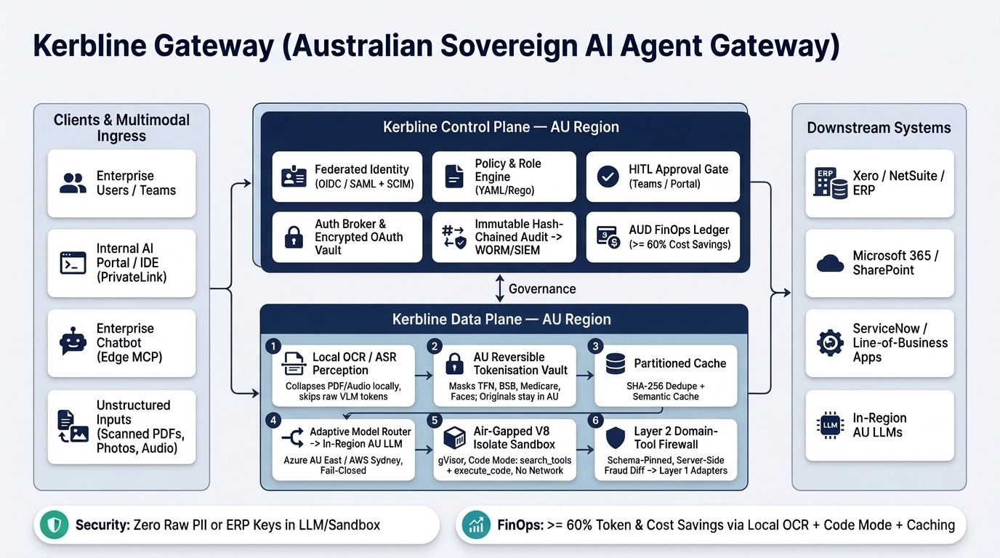
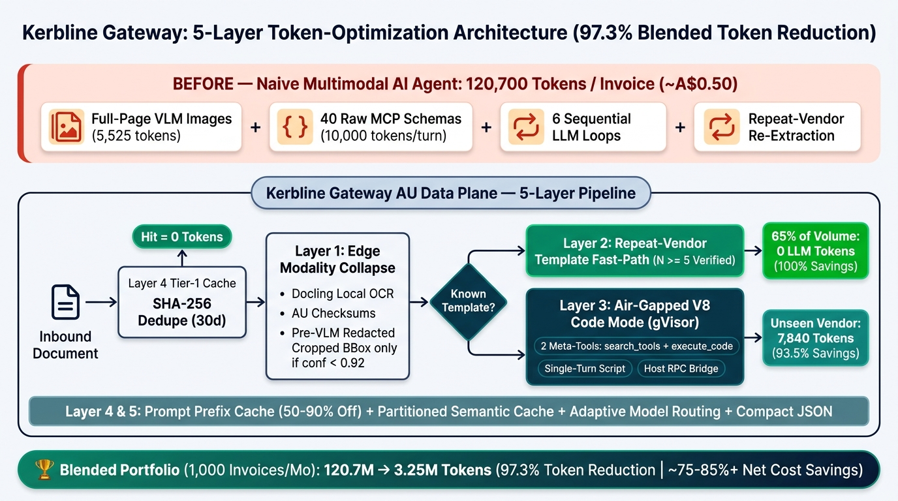

KERBLINE GATEWAY v4.4

Multimodal Product Design, Go-Live & Market Specification

Guardrails for every AI agent. Sovereign Australian agent gateway for documents, images, audio and ERP/CRM workflows: federated IdP identity, connector auth broker, pre-VLM AU text and visual tokenisation, dual-ingress + async ingestion, in-region inference, and a measured token FinOps engine

Version 4.4 | November 2026 | Supersedes v4.3

> **Target Architecture Notice (Synced 19 November 2026):** This document describes Kerbline Gateway's **target product architecture and roadmap**. It is **not** a statement of currently deployed production features. For the verified, test-backed status of what is currently deployed (`read-only MCP pilot with real GCP inventory`, 106 local tests, 14 live inventory checks) versus `Local`, `PoC`, `Planned`, or `Disabled`, see `Kerbline_Implementation_Status_2026-11-19.md`.

| Specification field | v4.4 definition |
| Product name | Kerbline Gateway: the governed agent gateway ("guardrails for every AI agent"), sold with Kerbline workflow packs (Kerbline AP first; then Claims, KYC, NDIS Intake) |
| Name status | Working name. Before public use: IP Australia trade mark search (classes 9 and 42), ASIC business-name check, and domain availability (.com.au, .ai) |
| Supported inputs | Scanned PDFs and forms, photos and screenshots, voice memos and call audio, structured ERP/CRM APIs |
| Beachhead (launch) workflow | Accounts payable: scanned invoice + delivery docket matching against Xero (Phase 0/1) and NetSuite (Phase 2) purchase orders |
| Target market | Australian mid-market (50–500 staff). Launch: finance-adjacent firms on Xero/NetSuite. Expansion: insurance/strata, logistics, healthcare/NDIS, KYC-heavy financial services |
| Regulatory alignment | APRA CPS 234 (<24–48 h incident notification SLA) and CPS 230 (service-provider obligations, RTO ≤ 4 h / RPO ≤ 15 min), APRA AI Letter to Industry (30 Apr 2026), Privacy Act/APPs incl. automated-decision disclosure (from Dec 2026), ACSC Essential Eight (ML1 Pilot, ML2 target at GA) |
| Identity | Federated customer IdP via OIDC (Phase 0) / SAML (Phase 2) + SCIM; MFA enforced via IdP; local accounts disabled for Enterprise/regulated tiers |
| Hosting | Default: Kerbline-managed single-tenant in an AU region (Phase 0/1). Enterprise: customer VPC/VNet (Phase 2). Launch on one cloud (Azure Australia East or AWS Sydney); GCP australia-southeast1 after GA |
| Client & ingestion ingress | Pattern 1: sovereign internal client over private network (MCP Streamable HTTP/SSE + REST UI API). Pattern 2 (Phase 2): approved enterprise chatbots via hardened edge MCP endpoint (read-only, non-PII by default). Async Ingestion: mailbox/SharePoint/blob triggers + mobile offline-sync queue |
| Model inference | In-region only (Azure OpenAI Australia East, Bedrock AU geographic profile, Vertex AI Sydney where available); no-training contractual terms (ZDR requested where supported); fail closed otherwise |
| Core differentiator | Working multimodal finance workflow in 4 weeks + pre-VLM AU text/visual data protection + compliance evidence pack + live AUD cost ledger |
| Go-to-market | Fixed-fee Proof of Value (A$25k, credited to year 1) converting to a tiered subscription |

# 0. Revision history (v4.0 → v4.4)

| Area | Earlier (v4.0–v4.3) | v4.4 change | Why it matters |
| Control vs. Data Plane (v4.4) | Single "Control Plane" box containing GPU OCR, V8 sandbox, and model gateway; no async ingestion | Explicit split between Control Plane (identity, policy, registry, durable workflow, audit/FinOps) and Data Plane (ingress, async queue, GPU perception, vault, V8-to-MCP bridge, model gateway) | Prevents noisy-neighbor coupling, clarifies scaling boundaries, and supports mailbox/SharePoint/offline mobile ingestion |
| V8 Sandbox & RPC Bridge (v4.4) | 32 MB / 5 s CPU vs `timeoutMs: 5000`; unspecified V8-to-MCP call path | Host RPC bridge specified; `64 MB RAM`, `5 s CPU` isolate limit with `30 s` wall-clock RPC budget; OS-level gVisor/Firecracker microVM isolation | Prevents multi-step ERP scripts from aborting prematurely and hardens against V8 engine escapes |
| Policy-to-Tool & Fraud Gates (v4.4) | `hitlEscalation` / `detokeniseOnlyFor` referenced hidden Layer 1 tools; `args.bankDetailsChanged` self-reported | Aligned to Layer 2 `domainTools` (`propose_payment_batch`, `change_supplier_bank_details`); replaced self-reported flag with server-side ERP supplier bank diffing + defined callback workflow | Closes policy bypasses where agents omit flags or hit unmapped tool names |
| Pre-VLM Redaction & GPU Isolation (v4.4) | Visual detection/redaction order ambiguous on VLM fallback; shared GPU pool for all | Mandatory pre-VLM visual/text redaction before cropping/escalation; RPC responses re-tokenised; dedicated GPU nodes or in-region managed OCR/ASR required for regulated tiers | Eliminates PII leakage to VLMs and cross-tenant GPU memory exposure |
| Audit, Retention & Resilience (v4.4) | DB-only hash chain; 30-day exit crypto-shredding vs 7-year audit conflict; no RTO/RPO or breach SLA | External WORM + SIEM audit anchoring; exit shreds operational data/vault keys while retaining tokenised/pseudonymised 7-yr audit logs; CPS 234 (<24–48 h SLA), CPS 230 (RTO ≤ 4 h, RPO ≤ 15 min), E8 ML1→ML2 | Meets APRA CPS 234/230 auditor expectations without legal contradictions |
| Identity & Caching (v4.4) | `local` accounts allowed; `dedupeBySha256` inside 1-hr `semanticCache` | `local` accounts disabled for Enterprise; SCIM <5 min revocation SLA; single-flight OAuth refresh lock; 30-day SHA-256 doc dedupe separated from 1-hr `pgvector` cache | Tightens zero-trust posture and makes duplicate-invoice caching effective |
| v4.1–v4.3 Baseline | Federated any-IdP + Auth Broker, reversible tokenisation, partitioned cache, measured shadow baseline, single-cloud launch, 10-wk MVP, `decisionRationale`, Kerbline rename | Retained and hardened in v4.4 | Preserves commercial wedge and pragmatic phased build |

# 1. Product vision and multimodal wedge

Australian mid-market organisations face two blockers moving agentic AI into production: risk teams will not let agents touch ERP, CRM and document stores without demonstrable controls, and finance teams reject rollouts when tool-calling and raw media uploads (scanned PDFs, photos, call recordings) make AI bills unpredictable.

Kerbline enters as a business outcome: one painful multimodal workflow automated in four weeks. It turns documents, images and audio into compact, protected structured data inside an Australian boundary, then performs governed actions in business systems. The gateway underneath becomes the approved path for every later agent.

| Positioning statement: For finance and operations leaders at Australian mid-market companies who process invoices, forms, photos and calls by hand, Kerbline is the governed agent platform that turns that paperwork into approved system actions in four weeks, keeps personal data protected and in Australia, and shows every dollar of AI spend in AUD. Unlike generic MCP gateways or OCR tools, Kerbline ships the workflow, the controls and the cost ledger together. |

## 1.1 Multimodal workflows (launch order)

| Order | Vertical | Inputs | Governed workflow |
| 1 (launch) | Finance & accounts payable | Scanned PDF invoices, delivery dockets, remittance screenshots | Extract line items locally, validate ABN and totals in the sandbox, match to Xero (Phase 0/1) or NetSuite (Phase 2) POs, queue payments > A$5k and any server-detected bank-detail change for approval |
| 2 | Insurance, strata & logistics | Inspection photos, damage images, technician voice memos | Transcribe locally, redact faces/IDs/signatures, analyse cropped damage regions, draft repair scope, create ServiceNow/ERP work orders |
| 3 | Financial services KYC | Driver licences, passports, Medicare cards, payslips | Tokenise ID numbers, run verification through an approved service (e.g., the government Document Verification Service via an accredited gateway), update CRM compliance records |
| 4 | Healthcare & NDIS providers | GP referrals, allied-health reports, phone intake recordings | Transcribe locally, tokenise identifiers, map NDIS support items, route high-cost plans for clinical sign-off. Health information is "sensitive information" under the Privacy Act: stricter consent and access controls apply |

## 1.2 Go-to-market phases

| Phase | Timeline | What the customer gets | Commercial outcome |
| 0. Readiness Gate | Week 0 (pre-PoV) | InfoSec questionnaire, NDA/DPA, external pen test summary, golden dataset curation (open/recent POs), pre-PoV AP clerk time baseline | Unblocks Week 1 OIDC/ERP access |
| 1. Proof of Value | Weeks 1–4 | AP invoice + docket matching live on Xero (Managed AU tenant, Teams approvals), measured AP time & AI cost vs baseline | A$25k fixed, credited to year 1 |
| 2. Gateway approval | Weeks 5–8 | Risk/IT review using the AU compliance evidence pack | Converts to Starter, Growth, or Enterprise subscription |
| 3. Expansion | Month 3+ | NetSuite, Claims, KYC, ServiceNow workflows, Pattern 2 Edge MCP, Customer VPC | Tier upgrade; workflow packs; media usage |

# 2. Market size and opportunity

## 2.1 Top-down: global category size

Third-party estimates in USD; they vary between firms, so use them for direction.

| Category | Current size | Forecast | Growth | Source |
| Agentic AI security | US$1.65B (2026) | US$13.52B (2032) | 42% CAGR | MarketsandMarkets |
| AI trust, risk & security management (AI TRiSM) | US$3.09B (2026) | US$11.61B (2031) | 30.3% CAGR | MarketsandMarkets |
| LLM gateways | US$2.18B (2025) | US$7.21B (2030) | 27.1% CAGR | The Business Research Company |

## 2.2 Bottom-up: Australian serviceable market (estimate)

ABS counts show about 68,300 Australian businesses with 20–199 employees and about 5,400 with 200+. Assumptions below are flagged for validation in customer discovery.

| Step | Estimate | Basis |
| Businesses with 50–500 staff | ~14,000 | Assumption: ~1 in 6 of the 20–199 band have 50+, plus most of the 200+ band below 500 |
| In target verticals | ~4,900 (35%) | Assumption from industry mix |
| Blended annual contract value | ~A$48k | Assumed mix: 40% Starter (A$30k), 50% Growth (A$60k), 10% Enterprise (A$108k), plus packs and media usage |
| Serviceable addressable market | ~A$235M per year | 4,900 × A$48k |
| Obtainable in 3 years | ~75 customers, ~A$3.6M ARR | ~1.5% share; founder-led, services-assisted |

## 2.3 Why now

APRA Letter to Industry on AI (30 April 2026): AI risk must be managed under CPS 220, CPS 230 and CPS 234, including misuse of autonomous agents.

CPS 230 applies to arrangements with all contracted service providers from 1 July 2026, so Kerbline will itself be assessed by regulated customers on operational resilience, RTO/RPO, and fourth-party risk.

ASIC letter (8 May 2026) on cyber resilience against frontier-AI threats.

Privacy Act (from December 2026): organisations must disclose in their privacy policy (APP 1.7–1.9) where substantially automated decisions significantly affect individuals. Kerbline’s `decisionRationale` record supports transparency and individual explanation requests; confirm exact legal obligations with counsel.

# 3. Competitive landscape

Products already exist for the gateway layer, and for document capture in the Xero ecosystem. None found combine multimodal intake, an Australian compliance pack, governed ERP actions and a token cost ledger for the mid-market. That combination is the moat; the gateway alone is not.

| Category | Examples (2026) | Strengths | Gap Kerbline exploits |
| Hyperscaler agent gateways | Amazon Bedrock AgentCore Gateway (Sydney); Microsoft Azure API Management / AI Foundry; Google Vertex AI agent tooling | In-region, native to customer cloud | Building blocks only; customer designs policies, DLP and workflows |
| API / AI gateway vendors | Kong AI Gateway; Cloudflare MCP Portals + Code Mode; Palo Alto Prisma AIRS AI Gateway (Portkey, acquired May 2026) | Mature traffic control, security brand | Sold to platform teams most mid-market firms lack |
| Dedicated MCP gateways | MintMCP, Runlayer, TrueFoundry, Bifrost, IBM ContextForge, Docker MCP Gateway, Obot, Composio | Per-user OAuth, SSO, audit | US-centric; no AU identifiers, APRA mapping or business outcome |
| Document capture / AP automation | Intelligent document processing (ABBYY, Azure AI Document Intelligence, Amazon Textract); Xero-ecosystem AP tools (Dext, ApprovalMax) | Proven extraction and approval flows; already in many Xero firms | Single-purpose; no agentic cross-system actions, no governed gateway for other agents |
| iPaaS with governed MCP | Workato (sovereign-model partnership with Gulanga), Tray.ai, Boomi | Large connector libraries | Enterprise pricing; little token FinOps |
| Australian AI governance / sovereign AI | Aigentsphere, ORCA Opti, ClearRoute Runkora, Trellis Data Agentaus, Airrived, EthicAI Selma, H2O.ai with CAN.B | Local presence, sovereignty story | Governance registries, assistants or hosting; not executing ERP workflows with approvals and cost ledger |

Your first sales objection will be "we already use Dext/ApprovalMax". Position Kerbline as handling the exceptions those tools leave (docket matching, PO variance, supplier queries) and as the governed path for the next agents, rather than a rip-and-replace.

Keep the gateway thin and pluggable; run on AgentCore Gateway or Azure APIM where the customer already uses them.

# 4. MCP server strategy: reuse, wrap, then build

In 2026 there are four sources of MCP servers, and business-system vendors now publish their own official servers. Kerbline reuses those as Layer 1 adapters and invests custom engineering in Layer 2 domain tools and Layer 3 governance.

## 4.1 Four sources of MCP servers

| Source | Examples | Where it runs | Kerbline stance |
| AI-provider connectors | Claude connectors, ChatGPT apps/connectors | Brokered from the AI provider’s cloud; region and retention depend on provider and plan | Not used for business-system access. Only as Pattern 2 clients pointing at Kerbline’s edge endpoint (Phase 2) |
| Official system-vendor servers | Xero MCP server (`@xeroapi/xero-mcp-server`, open-source, self-hostable); NetSuite AI Connector Service (hosted by NetSuite, honours NetSuite roles) | Self-hosted in Kerbline’s AU environment (Xero), or hosted by the system vendor where the customer's ERP data lives (NetSuite) | Reuse as Layer 1 system adapters behind the gateway; never exposed raw to agents |
| Community open-source servers | Servers for ERPNext, Odoo, Jira, etc. | Self-hosted | Only after security review; forked, version-pinned and scanned |
| Kerbline custom servers | AP domain tools, AU validation, legacy ERP adapters | Kerbline AU environment | Build where differentiated value exists (see 4.3) |

## 4.2 Three-layer tool architecture

| Layer | What it contains | Who builds it | Visible to agents? |
| 1. System adapters | Official vendor MCP servers (Xero, NetSuite) or direct APIs, called with per-user OAuth so the vendor’s own role checks still apply | Reused; Kerbline pins version and maintains config | No (read-only exceptions allowed by explicit policy) |
| 2. Domain tools (Kerbline IP) | Intent-based tools: `match_invoice_to_po`, `propose_payment_batch`, `change_supplier_bank_details` (always HITL + server-side diff), `verify_kyc_identity`. Each composes Layer 1 calls with validation, amount limits, tokenisation/re-tokenisation, and dry-run change plans | Kerbline, custom-built | Yes, via `search_tools()` filtered by role |
| 3. Gateway and policy | Identity, policy, durable HITL approvals, audit, FinOps ledger applied to every call regardless of server source | Kerbline core | Transparent to agents |

## 4.3 When custom-built servers are justified

- Legacy or on-premise systems with no MCP server or modern API (via the Hybrid Connector).
- Cross-system workflows (Xero + SharePoint + Teams) that no single vendor server can express.
- Australian-specific validation: ABN lookup, BSB format, server-side bank-detail change verification.
- Narrowing broad vendor scopes: vendor servers often need wide permissions (e.g., Xero transactions and contacts), so Layer 2 domain tools restrict what agents can actually invoke.
- Not justified: rebuilding full Xero or NetSuite connectors. Vendor APIs and scopes change regularly (Xero moved to granular scopes from April 2026), and tracking those changes is better left to the vendor.

## 4.4 Operating reused servers safely

| Control | Design |
| Version pinning & schema drift | Never run `@latest` in production; pin exact versions and record a SHA-256 hash of each tool schema. `schemaHashCheck: "block-on-change"` blocks unreviewed drift, with a fast-track diff/approval queue and staged rollout so benign vendor updates do not cause unmitigated outages |
| Contract tests | Weekly automated tests against each vendor’s sandbox/demo organisation; failures alert before customers notice |
| Policy precedence | Where vendor roles and Kerbline policy overlap, `strictest-wins`. Per-user OAuth keeps the vendor’s audit trail tied to the real user |
| Supply-chain review | Licence check, dependency scan and code review before any open-source server is adopted; forks kept in Kerbline’s registry |
| Residency | Self-hosted adapters (Xero) run in Kerbline's AU environment. Vendor-hosted servers (e.g., NetSuite AI Connector Service) process data where the customer’s NetSuite instance already holds it; explicitly disclosed in the CPS 230 evidence pack |

## 4.5 AI-provider connectors vs Kerbline-governed access

Behaviour differs by provider, plan and configuration, so each provider’s residency and retention terms must be verified. Typical differences:

| Dimension | AI-provider connector used directly | Through Kerbline |
| Network path | Calls originate from the AI provider’s cloud | Calls originate from Kerbline’s AU environment |
| Authorisation | Scopes granted per connector, often broad | Least-privilege scopes plus role-filtered Layer 2 domain tools |
| Tool granularity | Raw vendor tools | Intent-based domain tools with blast-radius limits |
| Personal data | Limited AU-specific protection | Pre-VLM AU text and visual tokenisation before inference |
| Cross-system governance | One policy per connector | One policy, audit trail and cost ledger across Xero, NetSuite, M365 and more |
| Approvals | Client-side confirmation prompts | Server-side durable approval gates in Teams/Slack with redacted preview |

# 5. Dual-ingress and async ingestion patterns

| Pattern | How traffic flows | Protocols, controls and when to use |
| 1. Sovereign internal client (private network) | Internal portal (Next.js / Open WebUI / LibreChat) or IDE over VPN, ExpressRoute or Direct Connect; private DNS to Kerbline and in-region model endpoints | Protocols: MCP over Streamable HTTP/SSE for agent clients; authenticated REST/JSON UI API for AP exception queue. No public internet hops; full AU residency and transit. Required for writes, customer PII, KYC and health data |
| 2. Approved enterprise chatbot (edge MCP — Phase 2) | Claude Enterprise, ChatGPT Enterprise or Microsoft Copilot connect to Kerbline’s edge MCP endpoint behind WAF and reverse proxy | OAuth 2.1 + PKCE, Dynamic Client Registration (DCR) strictly gated by vendor IP allow-listing and client metadata pinning, schema pinning, tokenisation, SIEM logging. Tool results are processed by the chatbot vendor’s model, so default to `read_only_non_pii` and verify vendor retention/region settings |
| 3. Async ingestion & offline mobile (Phase 0/1 mailbox; Phase 2 mobile) | Event-driven watchers for invoice mailboxes (M365 Graph webhooks/IMAP), SharePoint folders, and mobile field capture (offline-first local queue syncing via authenticated REST upload when online) | Enqueues media into durable AU job queue (Azure Service Bus / AWS SQS) decoupled from synchronous API pods; supports 90-day PoV backfills without starving interactive traffic |

# 6. System architecture (v4.4)

Kerbline v4.4 explicitly separates the **Control Plane** (identity, policy, registry, durable workflow state, audit/FinOps) from the **Data / Execution Plane** (ingress, async ingestion, GPU perception, tokenisation vault, V8 sandbox + RPC bridge, model gateway).



```text
USERS (any IdP)          CLIENTS: Pattern 1 (Private) | Pattern 2 (Edge)      ASYNC: Mailbox / SharePoint / Mobile
  | OIDC/SAML + SCIM       | MCP (HTTP/SSE) / REST UI API                      | Webhooks / Offline-Sync Upload
  v                        v                                                   v
+----------------------------------------------------------------------------------------------------------+
| KERBLINE CONTROL PLANE  (AU Region: Azure AU East | AWS Sydney | GCP Sydney)                             |
|                                                                                                          |
|  [C1] Federated Identity (OIDC/SAML + SCIM, <5m revocation) ---> [C2] Policy & Role Engine (YAML / Rego) |
|  [C3] Schema-Pinning & Connector Registry (Layer 1/2 metadata)                                           |
|  [C4] Durable Workflow Orchestrator (HITL pause/resume state, idempotency, dry-run validation)           |
|  [C5] Audit Aggregator (WORM + SIEM anchoring) & FinOps AUD Ledger                                       |
+----------------------------------------------------------------------------------------------------------+
        | policy, roles, schemas, workflow commands                       ^ audit events, token/GPU usage
        v                                                                 |
+----------------------------------------------------------------------------------------------------------+
| KERBLINE DATA / EXECUTION PLANE  (AU Region; isolated worker pools)                                      |
|                                                                                                          |
|  [D1] Ingress Proxy (WAF / PrivateLink) & Async Job Queue (Service Bus / SQS)                            |
|        |                                                                                                 |
|        v  (raw media)                                                                                    |
|  [D2] Modality Perception + Pre-VLM Redaction (Dedicated GPU / Managed OCR-ASR for regulated tiers)      |
|        |  1. Local OCR (Docling) / ASR (faster-whisper)                                                  |
|        |  2. Visual region detection (faces, IDs, signatures) + Text entity detection                    |
|        |  3. AU Text & Visual Tokenisation Vault (originals encrypted in AU KMS; non-deterministic tokens) |
|        |  4. ONLY redacted/blurred crops (<0.92 conf) escalate to VLM                                    |
|        v                                                                                                 |
|  [D3] Adaptive Router (deterministic: single read -> fast path | >=2 tools/joins/batch -> Code Mode)     |
|        |                                                                 |                               |
|        | (fast path)                                                     v (Code Mode)                   |
|        |                                                  [D4] V8 Isolate Sandbox (gVisor/Firecracker;   |
|        |                                                       no net/FS/env; 64 MB; 5 s CPU / 30 s RPC) |
|        |                                                       | typed RPC (static AST allow-list)       |
|        |                                                       v                                         |
|        |                                                  [D5] Host RPC Bridge (re-tokenises responses)  |
|        +-------------------------------------------------------+                                         |
|                                                                |                                         |
|                                                                v                                         |
|  [D6] Layer 2 Domain Tools (server-side ERP diffing, dry-run plan) ---> [C4] HITL Gate (Teams/Slack)     |
|        |                                                                                                 |
|        v                                                                                                 |
|  [D7] Connector Auth Broker + Token Vault (OBO | RFC 8693 | per-user OAuth + single-flight refresh)      |
|  [D8] In-Region Model Gateway (tiered LLM/VLM; fail closed) + Partitioned Caches (30d SHA-256 | 1h vec)  |
+----------------------------------------------------------------------------------------------------------+
        |                          |                          |
   Xero / NetSuite           M365 / SharePoint         ServiceNow / CRM / Hybrid Agent (Model C)
```

## 6.1 Identity: federated login + connector auth broker

Login uses OIDC (Phase 0) or SAML (Phase 2) with any identity provider; SCIM syncs groups into Kerbline roles. MFA is enforced at the customer IdP; `local` accounts are disabled (`allowLocalAccounts: false`) for Enterprise and regulated tiers. SCIM deprovisioning webhooks trigger active Kerbline session and cached OBO/OAuth token revocation within `< 5 minutes`.

| Mode | When used | Examples |
| On-Behalf-Of (OBO) | Target API trusts Microsoft Entra ID | Microsoft Graph, SharePoint, Teams |
| Token exchange (RFC 8693) | Target API trusts the customer’s IdP | Okta-protected internal APIs |
| Per-user OAuth + encrypted vault | Target has its own OAuth | Xero, NetSuite, Salesforce, ServiceNow |
| Scoped service account (fallback) | No per-user API access | Legacy ERPs and databases; user identity stamped on every call; strict Kerbline RBAC enforced |

Downstream tokens never enter the model context or V8 sandbox. Refresh tokens are encrypted with a per-tenant KMS key (BYOK/CMK supported on Enterprise VPC), protected by distributed single-flight locking to prevent parallel refresh races, and users can revoke consent from the portal.

## 6.2 Modality perception & pre-VLM redaction layer

1. **Documents (Universal Document-to-Markdown Normaliser):** Digital documents (`.docx`, `.xlsx`, `.csv`, `.eml`/`.html`, and native-text `.pdf`) are normalised on CPU directly into **clean Markdown** (`~20–80 ms`, `A$0.00` GPU, ~30–50% fewer tokens than verbose XML/JSON). Scanned PDFs and images run through local layout OCR (`docling-v2-local`), which exports clean Markdown for Code Mode while retaining `[x1, y1, x2, y2]` coordinates internally for the `N >= 5` Repeat-Vendor Template Fast-Path.
2. **Audio:** Local speech recognition (`faster-whisper-large-v3`). Recording consent notices are the customer’s responsibility; Kerbline records the consent flag per file.
3. **Mandatory Pre-VLM Redaction:** Before any cropped region (`vlmEscalationConfidence < 0.92`) or image is sent to a VLM, local region detection identifies faces, ID card numbers, and signatures, and text detectors identify TFN, Medicare, BSB/account, ABN/ACN, licence, and passport patterns. Regions are blurred/tokenised *prior* to VLM escalation so missed OCR characters or unredacted PII never reach the model.
4. **Compute & Isolation Options:**
   - **Regulated / APRA-covered tiers:** Dedicated per-tenant GPU node pool (with container-level memory zeroing) OR in-region managed services (Azure AI Document Intelligence / Speech in Australia East; Amazon Textract / Transcribe in Sydney).
   - **Standard Managed (Model A):** Shared GPU pool in Kerbline’s AU tenant is restricted to non-regulated workloads with strict per-job container isolation; customer-VPC GPU pool available in Model B (Phase 2).

## 6.3 AU text and visual tokenisation

- Detects TFN (checksum), Medicare, BSB + account, ABN/ACN, driver licence, passport, faces, and signatures.
- Replaces values with **non-deterministic, HMAC-salted random tokens** (preventing dictionary attacks on low-entropy TFNs/BSBs) or blurred image regions with a vault reference. Originals stay in an AU KMS-encrypted vault (with automated key rotation).
- **Controlled De-tokenisation & Return-Path Re-tokenisation:** Only explicitly permitted Layer 2 domain tools (e.g., `propose_payment_batch`, `verify_kyc_identity`) can de-tokenise outbound arguments, with every release audited. Crucially, the Host RPC Bridge scans **RPC responses** from Layer 1/2 systems and re-tokenises any sensitive fields (e.g., echoed BSB/account numbers) before data re-enters the V8 sandbox or LLM context.

## 6.4 Code Mode sandbox, V8-to-MCP bridge & safe writes

- **MicroVM + Isolate Isolation:** V8 isolates run inside OS-level sandboxes (gVisor / Firecracker / seccomp) with no network, filesystem, or environment variables. Resource limits: `64 MB` RAM, `5 s` CPU time inside V8, and `30 s` wall-clock timeout covering async host RPCs.
- **Static AST & Host RPC Bridge:** Generated JS/TS is statically checked against the user role’s RPC allow-list before execution. Inside V8, tool calls invoke a host-injected RPC binding (`Host RPC Bridge`), which serializes typed requests to Layer 2 Domain Tools → Layer 1 MCP adapters, enforces per-RPC timeouts, and re-tokenises responses.
- **Dry-Run, Durable HITL & Compensating Actions:**
  - Every write generates a dry-run change plan first. For APIs without native dry-run (e.g., Xero), Kerbline fetches current ERP state and computes a deterministic local diff/validation plan.
  - When HITL is required (`PAUSE_WITH_REDACTED_MEDIA_PREVIEW`), `[C4] Durable Workflow Orchestrator` persists the change plan, idempotency key, and tokenised context. Upon approval (up to hours later), the orchestrator re-validates ERP state (optimistic concurrency check) before executing.
  - Compensating actions per connector use explicit accounting reversals (e.g., voiding draft bills, issuing credit notes, or posting reversing journals) rather than unsupported deletes.

## 6.5 Audit vault and compliance evidence

- **Tamper-Evident External Anchoring:** Hash-chained audit records (user, role, input hash, generated code, change plan, tokens released, approver, model, tokens, AUD cost) are written to immutable WORM storage (Azure Immutable Blob / AWS S3 Object Lock) and streamed to customer SIEM (Sentinel, Splunk, Chronicle/SecOps, OTLP) on Growth+ tiers (scheduled/on-demand WORM export on Starter), preventing silent log rewriting even if the operational DB is compromised.
- **`decisionRationale`:** Every automated triage or approval outcome stores a plain-English, tokenised record of inputs evaluated, policy rule matched, confidence score, and human reviewer, exportable per individual to support Privacy Act transparency and explanation requests.
- **AU Compliance Evidence Pack:** Live-generated mapping for APRA CPS 234 (incl. `< 24 h` initial / `< 48 h` preliminary incident notification SLA), CPS 230 (RTO/RPO, DR/BCP, fourth-party register), ACSC Essential Eight (ML1 at Pilot, ML2 target at GA, PAM/break-glass controls), and Privacy Act/APPs.

## 6.6 Cross-cloud reference mapping

Packaged as Helm charts and Terraform modules. Launch on one cloud (whichever the first three customers use, defaulting to Azure Australia East or AWS Sydney), then add the others.

| Layer | Azure (Australia East) | AWS (ap-southeast-2) | GCP (australia-southeast1) |
| User identity | Customer IdP via OIDC/SAML | Customer IdP via OIDC/SAML | Customer IdP via OIDC/SAML |
| Ingress and WAF | Application Gateway + WAF | ALB + AWS WAF | Cloud Load Balancing + Cloud Armor |
| Control plane pods | AKS / Container Apps (stateless) | EKS / ECS Fargate (stateless) | GKE (stateless) |
| Data plane & media workers | AKS worker + isolated GPU node pool + Service Bus | EKS worker + isolated GPU node group + SQS | GKE worker + isolated GPU node pool + Pub/Sub |
| Cache, vault & ledger | Azure Cache for Redis + PostgreSQL (pgvector) + Key Vault + Immutable Blob | ElastiCache + Aurora PostgreSQL (pgvector) + KMS + S3 Object Lock | Memorystore + Cloud SQL (pgvector) + Cloud KMS + Bucket Lock |
| Private network | Private Link / Private Endpoints | PrivateLink / interface endpoints | Private Service Connect |
| Models (fail closed in-region) | Azure OpenAI Australia East | Bedrock (AU geographic profile) | Vertex AI Sydney |
| SIEM | Microsoft Sentinel | Security Lake / Splunk | Google Security Operations |

# 7. Low-token and multimodal FinOps engine

v4.4 measures savings against a shadow baseline (`naive full-page images + raw tool calls`). Public benchmarks support the direction (Cloudflare reported Code Mode saving ~32% on a simple task and ~81% on a batch task; Azure OpenAI / AWS Bedrock prompt prefix caching yields 50–90% input discounts), and local OCR/ASR removes most image and audio tokens. See `Kerbline_Token_Optimization_Architecture.md` for full token-by-token math.



| 5-Layer Stack | Mechanism | Phase & Design Rules | Expected Impact |
| 1. Edge modality collapse & pre-pass | Local OCR (`docling-v2-local`, Phase 0) / ASR (`faster-whisper-large-v3`, Phase 2); AU checksums (ABN/TFN/BSB/GST); pre-redacted cropped BBox VLM escalation only `< 0.92` conf | GPU/managed-OCR cost tracked in the same AUD ledger as tokens | Eliminates 1,105–4,784 vision tokens/page |
| 2. Repeat-vendor template fast-path | Deterministic Layout & Mapping Template compiled after `N >= 5` consecutive verified straight-through matches for a recurring supplier ABN | Phase 0/1 (Xero + Docling); Phase 2 (NetSuite). Falls back to Code Mode on layout drift or variance | **0 LLM tokens** on ~65% of recurring AP volume |
| 3. Code Mode (2 meta-tools + V8) | `search_tools()` + `execute_code()` inside V8/gVisor (`64 MB`, `5 s CPU`, `30 s RPC`); chains OCR, validation & ERP calls in 1 turn via Host RPC Bridge | Deterministic Adaptive Router triggers Code Mode when `>= 2` tools, pagination, joins or batches | Removes 40+ MCP schemas & multi-turn loops (~32–81% savings) |
| 4. 4-Tier caching | (a) `SHA-256` exact doc dedupe (`30d TTL`), (b) vendor-template cache, (c) provider prompt prefix cache (`50–90%` off), (d) partitioned `pgvector` semantic cache (`1h TTL`, `0.96` threshold) | Partitioned by `tenant + role + dataScope`; semantic cache strictly for `policy_docs` / `reference_guides` (never live ERP balances) | Removes repeat work & prefix overhead |
| 5. Adaptive routing, cascade & compaction | Deterministic router; compact-to-frontier model cascade; schema-constrained JSON outputs; rolling memory compaction (`6k -> <=1.5k`) | Confidence threshold escalates; structured outputs where supported | Caps output & long-session tokens |

**5-Page Scanned Invoice + 3-Way PO Match Benchmark:**
- **Naive 6-Turn VLM + 40 MCP Schemas:** `119,200` input + `1,500` output = **`120,700` tokens** (`~A$0.50/doc`).
- **Kerbline Path A (Unseen Vendor — Docling OCR + 1 Cropped BBox + Code Mode):** `7,340` input + `500` output = **`7,840` tokens** (**93.5% reduction**).
- **Kerbline Path B (Repeat Vendor — `N >= 5` Template Fast-Path):** **`0` LLM tokens** (**100% reduction**).
- **Blended Portfolio (1,000 docs/mo @ 65% fast-path / 30% Path A / 5% exception):** `3.25M` tokens vs `120.7M` (**97.3% raw token reduction**; **> 75–80% net AUD cost reduction** incl. `A$0.04/page` local OCR).

## 7.1 Measurement and guardrails

- **PoV Weeks 1–2:** Shadow mode with naive processing (full page images, raw tool calls) on recent open POs and a curated golden dataset to record a measured AI cost baseline, alongside a pre-PoV AP clerk handling-time baseline.
- **Week 3 onward:** Optimised; the ledger shows actual, baseline and saving per layer, including GPU/managed-OCR cost.
- **Contract wording:** "Target 50–80% lower AI processing cost on multi-step and document workflows versus the measured naive baseline"; no commercial guarantee.
- **Budget guardrails:** Per-run token ceiling (default 12k), daily AUD budget per department (alert 80%; at 100%, configurable `degrade_to_draft_queue` or `hard_stop` so urgent month-end invoices are not silently dropped), and loop detection.

# 8. Reliability, accuracy, resilience & safety

| Control | Design |
| Evaluation harness | Golden dataset per workflow (≥200 labelled real documents/recordings from the customer); every change replayed before release |
| Accuracy targets | AP: `≥ 90%` (Pilot) / `≥ 95%` (GA) correct field extraction and PO matching on straight-through items; low-confidence items route to the human exception queue |
| Bank-detail change fraud | **Server-side ERP diffing:** Layer 2 tools fetch the authoritative supplier bank record from Xero/NetSuite and compare BSB/account. Any mismatch triggers `BLOCK_UNTIL_CALLBACK_VERIFIED` using the trusted phone number stored in the ERP/vendor master (never the invoice), with verifier ID and call reference logged |
| Safe writes & concurrency | Dry-run change plan → policy → durable HITL approval → ERP state re-validation → execute with idempotency key; accounting-safe compensating actions per connector |
| Kill switch | Per workflow and tenant; pauses writes instantly |
| Model and GPU fallback | Cross-provider in-region model fallback where configured (e.g., Azure AU East → Bedrock Sydney) while keeping `allowGlobalRouting: false`; managed OCR/ASR service fallback; degrade to "draft for human" |
| Continuity (CPS 230) | `99.5%` gateway availability SLO; `RTO ≤ 4 hours`, `RPO ≤ 15 minutes` (multi-AZ AU deployment + encrypted cross-AU-region backups); annual DR test; fourth-party risk register |
| Incident notification (CPS 234) | `< 24 hours` initial security incident notification (`< 48 hours` preliminary assessment) to support customer 72-hour APRA reporting |
| Prompt injection (incl. text inside images/PDFs) | Extracted content treated as untrusted data; role-based static AST RPC allow-list; tools cannot grant permissions; HITL gates enforced server-side |
| Observability | OpenTelemetry traces; SLOs: `99.5%` gateway availability, `p95` fast-path `< 3 s`, `p95` invoice processing `< 60 s` |

# 9. Customer experience: what go-live looks like

| Persona | Experience | What makes them happy | Design requirement |
| AP clerk | Queue of extracted invoices shown side-by-side with the redacted source and PO match | Less keying; clear reason for each match | Exception-first queue; one-click correct-and-learn |
| Field technician / intake staff | Records a voice memo or takes a photo; a work order or intake record appears (Phase 2) | No forms on a phone | Mobile-friendly capture; offline queue |
| Finance controller | Teams (Phase 0) / Slack (Phase 2) card for payments > A$5k with redacted invoice preview and change plan | Approve from phone in seconds | Shows supplier history and server-verified bank-change flag |
| CFO | Weekly digest: documents processed, clerk hours saved, AUD spend vs baseline | Board-ready numbers | Excel export; budget alerts |
| CISO / risk | Audit explorer, redaction counters, WORM/SIEM logs, evidence pack | Answers auditors without engineering | One-click export |
| IT admin | Connects IdP, approves consents, sets roles | Guided setup | Guided wizard; least-privilege scopes pre-filled |

## 9.1 Onboarding timeline (first value ≤ 10 business days, post-Week 0 Readiness)

| When | Milestone |
| Week 0 (Readiness) | NDA/DPA, InfoSec review, pen test summary shared, sample open POs & golden dataset curated, pre-PoV AP clerk time baseline recorded |
| Day 1 | Managed AU tenant provisioned; OIDC IdP + SCIM connected; roles mapped |
| Day 2–3 | Xero OAuth consent; invoice mailbox or SharePoint folder connected; AU text tokenisation policy applied |
| Day 4–8 | Shadow mode on recent open POs & golden set: baseline AI cost and accuracy measured |
| Day 10 | First value: AP clerks working from the Kerbline queue (suggest mode, no auto-writes) |
| Week 3 | Approved writes on under thresholds; Teams approvals live |
| Week 4 | PoV readout: accuracy (`≥ 90%`), clerk hours saved, AUD ledger, draft evidence pack |

# 10. Deployment models and shared responsibility

| Model | For whom | How it runs | Who operates |
| A. Managed single-tenant (default, Phase 0/1) | Most 50–500-staff customers | Dedicated tenant in Kerbline’s AU cloud account; isolated GPU pool (or managed OCR/ASR for regulated tiers); private connectivity where needed | Kerbline |
| B. Customer VPC/VNet (Enterprise, Phase 2) | APRA-regulated or policy-mandated | Helm/Terraform into customer AU region, own GPU pool or managed OCR/ASR, customer-managed KMS (BYOK) | Shared: signed upgrades by Kerbline; infrastructure by customer |
| C. Hybrid connector (Phase 2) | On-prem ERP, file shares | Outbound-only mTLS/WebSocket connector agent in customer network authenticating to local AD/Kerberos/service principals with least-privilege share scopes | Customer hosts; Kerbline configures |

## 10.1 Responsibility matrix

| Activity | Managed (A) | Customer VPC (B) |
| Identity provider, user lifecycle, group membership, MFA | Customer | Customer |
| Connector consents and least-privilege scopes | Customer approves; Kerbline configures | Customer approves; Kerbline configures |
| Cloud infrastructure, patching, backups, DR testing | Kerbline | Customer (Kerbline provides runbooks) |
| Kerbline software upgrades & PAM/break-glass ops | Kerbline | Kerbline ships; customer approves window |
| Policies (thresholds, approvers, data rules) | Customer owns; Kerbline advises | Customer owns; Kerbline advises |
| Monitoring and incident response (<24h breach notice) | Kerbline (customer notified) | Joint; customer SOC leads |
| Recording consent and privacy notices | Customer | Customer |
| Evaluation datasets and accuracy sign-off | Joint | Joint |

# 11. Data protection lifecycle

| Topic | Design |
| Retention & exit resolution | **Source media:** configurable, default 30 days after processing. **Tokenisation vault entries:** kept only while the related operational record needs them. **Audit records:** default 7 years in WORM/SIEM. **On contract exit (within 30 days):** all operational data, source media, OAuth tokens, and tokenisation vault keys are exported and crypto-shredded (with a deletion certificate); immutable 7-year audit logs remain **tokenised/pseudonymised** (stripped of PII originals and vault keys) to satisfy both exit erasure and statutory audit retention |
| Tenant isolation proof | Separate database, KMS vault keys, and storage per tenant; dedicated GPU nodes or managed OCR/ASR for regulated tiers; automated cross-tenant access tests on every release; external penetration test prior to Pilot #1 and annually thereafter |
| Sensitive information | Health, biometric and identity data flagged per record; stricter access roles and shorter retention by default |
| Model providers | In-region AU endpoints with contractual no-training on customer data (zero-data-retention exemptions requested where provider supports them); provider terms recorded in the CPS 230 fourth-party register |

# 12. Commercial model and liability

| Offer | Price (AUD, ex GST) | Includes |
| Proof of Value | A$25,000 fixed, credited to year 1 | One workflow (AP on Xero, Managed AU tenant, Teams), 4 weeks, measured baselines, draft evidence pack |
| Starter | A$2,500 / month | Managed tenant, 1 workflow, 25 users, WORM audit export, business-hours support |
| Growth | A$5,000 / month | 3 workflows, 100 users, real-time SIEM streaming, full evidence pack |
| Enterprise | From A$9,000 / month | Customer VPC (Phase 2) or dedicated-GPU managed, BYOK KMS, unlimited workflows, 24×7 Sev-1 |
| Workflow packs | A$1,000 / month per additional pack | Pre-built domain tools and golden evaluation sets (Claims, KYC, NDIS Intake) |
| Media processing | Indicative A$0.04 / page; A$0.08 / audio minute | Covers GPU pool or managed OCR/ASR. Validate gross margin against measured cost before publishing |
| LLM usage | Pass-through at cost (or customer keys) | Shown in the AUD ledger |

## 12.1 Liability for agent actions

- Contract states that writes above thresholds require customer approval, and that approved actions are the customer’s decision.
- Kerbline liability capped (e.g., 12 months’ fees) with carve-outs negotiated for data breach caused by Kerbline.
- Hold professional indemnity and cyber insurance before the first paid pilot; get legal advice on terms.

# 13. Declarative policy (kerbline.policy.yaml v4.4)

```yaml
apiVersion: kerbline.io/v4.4
kind: MultimodalTenantPolicy
metadata:
  tenantId: "au-midmarket-finserv-01"
  hosting: "managed-single-tenant"          # managed-single-tenant | customer-vpc
  cloudProvider: "azure"                    # azure | aws | gcp
  region: "australiaeast"
  complianceFrameworks: ["APRA_CPS_234", "APRA_CPS_230", "AU_PRIVACY_APP", "ESSENTIAL_EIGHT_ML1"] # ML1 (Pilot) | ML2 (GA)

identity:
  provider: "oidc"                          # oidc (Phase 0) | saml (Phase 2)
  allowLocalAccounts: false                 # disabled for Enterprise & regulated tiers
  enforceIdpMfa: true
  groupSync: "scim"
  sessionRevocationSlaSeconds: 300
  roleMapping:
    "Finance-AP": "ap-clerk"
    "Finance-Controllers": "finance-controller"

connectors:                                 # Layer 1: system adapters (hidden from agents)
  xero:
    source: "vendor-official-selfhosted"    # @xeroapi/xero-mcp-server, run in AU env
    version: "<exact version, set at pin time>"
    schemaSha256: "<recorded at pin time>"
    schemaHashCheck: "block-on-change"
    auth: { mode: "per_user_oauth", vaultKey: "kms:customer-au-01", singleFlightRefresh: true }
    exposeRawToolsToAgents: false
  netsuite:                                 # Phase 2
    source: "vendor-hosted"                 # NetSuite AI Connector Service (runs in NetSuite region)
    auth: { mode: "per_user_oauth", singleFlightRefresh: true }
    exposeRawToolsToAgents: false
  graph:     { source: "direct-api", auth: { mode: "obo" } }
  legacyErp: { source: "kerbline-custom", auth: { mode: "scoped_service_account", auditUserStamp: true } }

domainTools:                                # Layer 2: Kerbline IP, visible to agents
  - match_invoice_to_po
  - propose_payment_batch
  - change_supplier_bank_details            # always HITL + server-side ERP diff + callback verification
policyPrecedence: "strictest-wins"

ingress:
  pattern1_private:
    enabled: true
    requirePrivateEndpoint: true
    protocols: ["mcp_streamable_http", "rest_ui_api"]
  pattern2_edgeChatbot:                     # Phase 2
    enabled: false
    oauthMode: "OAUTH2_1_PKCE_DCR"
    dcrRequireVendorIpAllowList: true
    enforceSchemaPinning: true
    allowedToolClasses: ["read_only_non_pii"]
  asyncIngestion:
    enabled: true
    sources: ["m365_mailbox_webhook", "sharepoint_folder"]
    mobileOfflineSync: false                # Phase 2

modalityPerception:
  compute: "dedicated-gpu-or-managed"       # dedicated-gpu-or-managed | managed-gpu-pool | customer-gpu
  ocrEngine: "docling-v2-local"
  asrEngine: "faster-whisper-large-v3"      # Phase 2
  redactBeforeVlmEscalation: true           # mandatory pre-VLM text & visual redaction
  vlmEscalationConfidence: 0.92
  requireRecordingConsentFlag: true

inference:
  providers: ["azure-openai-australiaeast", "azure-ai-gateway-au", "nvidia-nim-byok"]
  allowGlobalRouting: false                 # fail closed if model not in-region
  requestZeroDataRetention: true            # no-training contractual; ZDR exemption where supported
  modelAliases:                             # retargetable without workflow/client code changes
    kerbline-fast: "gpt-4o-mini-au"
    kerbline-vlm-crop: "nemotron-3.5-super-vl-au"
    kerbline-codemode: "gpt-4o-au"
  policyEvaluationOrder:                    # deterministic short-circuit chain (never reaches backend on block)
    - "1_privatelink_ip_filter"
    - "2_oidc_scim_auth"
    - "3_daily_aud_budget_cap"
    - "4_au_pii_tokenisation_vault"
    - "5_static_ast_gate"
    - "6_server_side_bank_diff"
    - "7_hitl_approval_gate"
  observability:
    otelMetric: "gen_ai.client.token_usage" # standard OTel GenAI metric + identity claim attributes
    includeIdentityClaims: true

finops:
  executionStrategy: "ADAPTIVE_HYBRID"
  routerMode: "deterministic_rules"
  baselineMode: "shadow-measured"
  maxTokensPerRun: 12000
  dailyBudgetAud: 150.00
  onBudgetExhausted: "degrade_to_draft_queue" # degrade_to_draft_queue | hard_stop
  repeatVendorFastPath:
    enabled: true                           # Phase 0/1 (Xero + Docling); Phase 2 (NetSuite)
    minVerifiedInvoices: 5                  # N >= 5 consecutive straight-through matches
    fallbackOnDrift: "code_mode"
  documentDedupe:
    enabled: true
    method: "sha256"
    partitionBy: ["tenant", "role", "dataScope"]
    ttlSeconds: 2592000                     # 30 days for exact-duplicate documents
  semanticCache:
    enabled: true
    partitionBy: ["tenant", "role", "dataScope"]
    allowedContent: ["policy_docs", "reference_guides"]
    similarityThreshold: 0.96
    ttlSeconds: 3600

security:
  sandbox:
    runtime: "V8_ISOLATE_IN_GVISOR"
    network: "DISABLED"
    memoryMb: 64
    cpuTimeoutMs: 5000
    rpcWallTimeoutMs: 30000
  writes:
    dryRunFirst: true
    idempotencyKeys: true
    recheckErpStateOnResume: true
  audit:
    wormAnchoring: true
    siemStreaming: true                     # Growth+ tier
  emitDecisionRationale: true

australianDlp:
  mode: "TOKENISE"
  tokenFormat: "non_deterministic_hmac_salted"
  retokeniseRpcResponses: true
  textEntities: ["AU_TFN", "AU_MEDICARE", "AU_BSB_ACCOUNT", "AU_ABN", "AU_DRIVER_LICENCE"]
  visualClasses: ["FACE", "ID_CARD_NUMBER", "SIGNATURE"] # Phase 2
  detokeniseOnlyFor: ["propose_payment_batch", "change_supplier_bank_details", "verify_kyc_identity"]

hitlEscalation:
  - ruleId: "high-value-ap"
    toolPattern: "propose_payment_batch"
    condition: "args.totalAmountAud > 5000"
    action: "PAUSE_WITH_REDACTED_MEDIA_PREVIEW"
    approverRole: "finance-controller"
  - ruleId: "bank-detail-change"
    toolPattern: "propose_payment_batch|change_supplier_bank_details"
    serverSideDiff: "erp_supplier_bank_record" # ignores agent-supplied flags; diffs live ERP record
    condition: "serverDiff.bankDetailsChanged == true"
    action: "BLOCK_UNTIL_CALLBACK_VERIFIED"
    trustedNumberSource: "erp_vendor_master"

dataLifecycle:
  sourceMediaRetentionDays: 30
  auditRetentionYears: 7                    # tokenised/pseudonymised WORM audit
  exitCryptoShredDays: 30                   # shreds operational data, media, OAuth & vault keys
```

# 14. Build and go-live roadmap

| Phase | Weeks | Scope | Exit gate |
| 0. MVP (documents first) | 1–10 | Control/Data Plane split; `search_tools` + `execute_code` (V8 in gVisor + Host RPC Bridge); deterministic Adaptive Router; repeat-vendor template fast-path (`N >= 5`, Xero + Docling); OIDC + SCIM (<5m revocation); per-user OAuth vault (Xero); local PDF OCR on isolated GPU/managed service; async mailbox/SharePoint queue; AU text tokenisation (pre-VLM + response re-tokenisation); durable HITL + Teams approvals with text-redacted preview; server-side ERP bank-change diff + callback gate; FinOps ledger v1; WORM audit log; in-region inference; evaluation harness | AP extraction + matching `≥ 90%` on golden set; external sandbox & vault pen test passed |
| 1. Paid pilot #1 | 11–14 | Managed AU tenant; Week 0 readiness gate; shadow baseline (open POs + clerk time); suggest mode → approved writes; repeat-vendor templates calibrated | PoV accepted (`≥ 90%` accuracy); converts to subscription |
| 2. Hardening + vision/audio | 15–24 | Visual tokenisation (blurring), local ASR (`faster-whisper`), Pattern 2 edge ingress, SAML/Okta + RFC 8693 exchange, NetSuite (+ NetSuite repeat-vendor templates), Slack/ServiceNow, mobile offline capture, customer-VPC Helm (BYOK KMS), Hybrid Connector (Model C), full evidence pack, ISO 27001 readiness, Essential Eight ML1→ML2 assessment | Two more pilots; no Sev-1 for 30 days |
| 3. GA | ~Month 6–7 | Setup wizard, tiers, second workflow pack (claims or field work orders), second cloud | 3 referenceable customers; gross margin > 60% incl. GPU |

Team for the MVP: 2 backend/platform engineers, 1 ML engineer (OCR/ASR, evals), 1 full-stack engineer, 1 forward-deployed solutions engineer, part-time security advisor.

# 15. Key risks and mitigations

| Risk | Likelihood | Mitigation |
| Hyperscalers or Xero-ecosystem tools offer "good enough" for free | High | Sell the outcome + AU compliance pack; complement Dext/ApprovalMax rather than replace |
| OCR/vision accuracy on poor scans and handwriting | Medium | Pre-VLM redaction + confidence routing to VLM and humans; golden datasets; suggest mode first |
| GPU cost erodes margin | Medium | Isolated/batched pool, managed-service fallback, media priced as usage (validate unit economics pre-GA) |
| Cross-tenant or cross-user leakage | Low (by design) | Partitioned caches/vaults; dedicated GPU or managed OCR for regulated tiers; automated isolation tests each release |
| Pattern 2 or NetSuite residency misread | Medium | Pattern 2 read-only non-PII default; NetSuite vendor-hosted region disclosed in CPS 230 pack |
| Long security reviews stall pilots | High | Week 0 Readiness Gate, pre-filled questionnaire, external pen test before Pilot #1 |
| Payment fraud via changed bank details | Medium | Server-side ERP diffing + callback to trusted vendor-master number; never auto-approved |
| Vendor MCP server or API changes break workflows | Medium | Version pinning, schema-hash checks with fast-track diff review, weekly contract tests |
| "Our ERP already connects to Claude" objection | High | Position Kerbline as the governed layer on top of the vendor connector, not a replacement |
| Name conflict found after launch | Low–Medium | Complete IP Australia trade mark search and register in classes 9 and 42 before public launch |
| Savings disputed | Medium | Measured naive AI + clerk-time baselines agreed in PoV statement of work |

# 16. Go-live success metrics

| Metric | Pilot target | GA target |
| Time to first value | ≤ 10 business days (post-Week 0) | ≤ 5 business days |
| Invoice extraction + PO match accuracy | ≥ 90% | ≥ 95% |
| AP processing time per invoice | −50% | −70% |
| AI processing cost vs measured naive baseline | −50% | −60% to −80% |
| Approval turnaround | < 4 business hours | < 1 business hour |
| PoV → subscription conversion | ≥ 60% | ≥ 70% |

# Appendix: sources

MarketsandMarkets, Agentic AI Security Market – Global Forecast to 2032: marketsandmarkets.com

MarketsandMarkets via SecurityWorldMarket, AI TRiSM market to US$11.61B by 2031: securityworldmarket.com

The Business Research Company, Large Language Model Gateways Market Report: thebusinessresearchcompany.com

ABS, Counts of Australian Businesses, including Entries and Exits: abs.gov.au

Vanta, APRA’s AI guidance for banks and insurers (Sep 2026): vanta.com

HWL Ebsworth, APRA AI reminder ahead of CPS 230 deadline: hwlebsworth.com.au

King & Wood Mallesons, ASIC and APRA call to action on AI: mallesons.com

Accountants Daily, Privacy Act automated-decision disclosure: accountantsdaily.com.au

Tyk, Speakeasy, MintMCP comparisons of enterprise MCP gateways (2026)

AWS, Bedrock AgentCore endpoints (Sydney) and AU geographic cross-Region inference: docs.aws.amazon.com, aws.amazon.com

WorkOS, Cloudflare Code Mode cuts token usage by 81%: workos.com

Xero, official Xero MCP server (XeroAPI/xero-mcp-server, MIT) and hosted remote MCP server: github.com/XeroAPI, mcpservers.org, developersdigest.tech

Oracle NetSuite, NetSuite AI Connector Service: netsuite.com/portal/products/artificial-intelligence-ai/mcp-server.shtml; docs.oracle.com

CData, Secure data in AI: how ChatGPT and Claude connect to remote MCP servers: cdata.com/blog

TechPartner.news, Aigentsphere seed round; IT Brief Australia, Workato & Gulanga, ClearRoute Runkora, ORCA Opti
