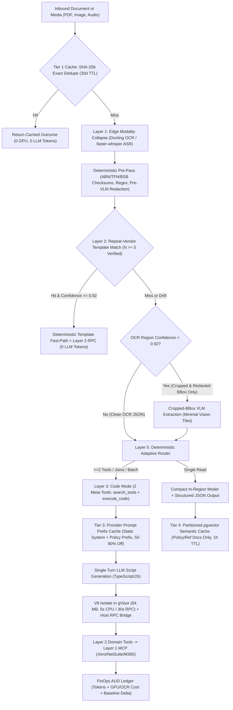

# Kerbline Gateway: Multi-Layer Token Optimization Architecture

> **Status Sync (19 November 2026):** Bounded local execution plans and local aggregation before inference are **Deployed** (verified synthetic payload reduction: `1,839 → 46` input tokens, **97.5%** reduction). Arbitrary generated JS is **Disabled**, and hardened gVisor/Firecracker Code Mode, repeat-vendor zero-token templates, document dedupe/semantic/prefix caches, adaptive routing, and net AUD reconciliation are **Planned** (see `Kerbline_Implementation_Status_2026-11-19.md`).

**Target:** 60–85%+ LLM token reduction (and 100% reduction on repeat-vendor fast-path) while preserving full Australian data residency, deterministic fraud controls, and `p95 < 60 s` invoice processing SLOs.
**Aligned with:** `Kerbline_Gateway_Product_Design_v4.4.md` (§5–§8, §13).

---

## 1. Executive Overview: Why Naive Multimodal Agents Blow Up Token Bills

Naive agentic document workflows suffer from four compounding token multipliers:
1. **Uncollapsed Vision Payloads:** Sending every page of a scanned PDF as a high-detail image consumes **1,105–4,784+ vision tokens per page** (OpenAI GPT-4o high-detail uses `85 + 170 × tiles` for 512×512 tiles; Anthropic Claude high-res scales up to `4,784` tokens/page plus extracted text).
2. **MCP Schema Bloat:** Injecting 40–60+ raw ERP/CRM/M365 MCP tool JSON schemas into every LLM call adds **8,000–15,000 input tokens per turn** before any document data is read.
3. **Multi-Turn Sequential Loops:** Traditional tool-calling requires 5–10 LLM round-trips per invoice (fetch supplier → fetch PO → fetch docket → check bank details → propose batch), re-sending the entire conversation history and intermediate ERP JSON payloads on every turn.
4. **Zero Memory Across Repeat Vendors:** Re-running full VLM + LLM extraction on every monthly Telstra, AWS, or Bunnings invoice pays the same token tax indefinitely.

Kerbline Gateway eliminates these multipliers through a **5-layer token-minimisation stack** executed inside its Australian Data Plane.

---

## 2. End-to-End Token Optimization Pipeline

---

## 3. The 5-Layer Token-Minimisation Architecture

### Layer 1: Edge Modality Collapse & Deterministic Pre-Pass
- **Local Perception:** All inbound PDFs, images, and audio are processed first by local models in Kerbline's AU Data Plane (`docling-v2-local` for layout-aware PDF/table OCR; `faster-whisper-large-v3` for audio), collapsing multi-megabyte raw media into compact structured JSON (~250–350 tokens/page vs. 1,105–4,784 vision tokens/page).
- **Deterministic Checksum & Regex Pre-Pass:** Before any LLM runs, deterministic extractors parse and validate:
  - **ABN** (11-digit weighted checksum) & **ACN** (9-digit checksum)
  - **TFN** (Mod 11 checksum) & **Medicare** (checksum)
  - **BSB + Account** (`XXX-XXX` format)
  - **GST & Line-Item Arithmetic** (`subtotal + 10% GST == total` check)
- **Pre-VLM Redaction & Cropped-BBox Escalation:** Only regions with OCR confidence `< 0.92` (e.g., handwritten delivery-docket signatures or smudged totals) are cropped, **redacted for PII prior to escalation**, and sent to a VLM as a minimal bounding-box tile (`~255` tokens) rather than a full-page render.

### Layer 2: Repeat-Vendor Deterministic Template Fast-Path (0 LLM Tokens)
Most mid-market AP volume (60–75%+) comes from recurring suppliers (utilities, cloud, logistics, regular wholesalers) with fixed invoice layouts.
- **Template Promotion Gate:** After `N = 5` consecutive human-verified, straight-through matches for a supplier ABN with zero manual field corrections, Kerbline compiles a versioned **Vendor Layout & Mapping Template**:
  - Layout fingerprint (header/table anchor bounding boxes from Docling)
  - Deterministic field extraction rules (invoice #, date, PO #, line-item columns, total)
  - Default Xero/NetSuite supplier ID and GL/tax-code mapping
- **Zero-Token Execution:** Subsequent invoices matching that supplier ABN and layout fingerprint bypass LLM/VLM inference entirely—executing extraction, arithmetic validation, 3-way PO matching, and `propose_payment_batch` in deterministic code (**0 LLM tokens**).
- **Drift Guard:** If any anchor box is missing, a checksum fails, or PO variance exceeds policy tolerance, the fast-path aborts cleanly and routes the document to Layer 3 (Code Mode).

### Layer 3: Code Mode (2 Meta-Tools + Single-Turn V8 Execution)
Inspired by Cloudflare's Code Mode paradigm (benchmarked at **~32% token savings** on simple tasks and **~81% savings** on multi-step/batch workflows):
- **Progressive Tool Discovery (`search_tools`):** Instead of stuffing 40+ MCP schemas into every prompt, Kerbline exposes **only 2 meta-tools**:
  1. `search_tools(domain, intent)` — returns only the 2–4 role-permitted Layer 2 domain tool signatures needed for the task (~400 tokens total).
  2. `execute_code(script)` — runs an LLM-generated TypeScript/JS script inside a network-disabled **V8 isolate inside gVisor/Firecracker** (`64 MB RAM`, `5 s CPU`, `30 s wall-clock RPC budget`).
- **Single-Turn Loop Collapse:** The LLM writes one script that loops over line items, fetches PO + delivery docket via the **Host RPC Bridge**, runs 3-way matching, and calls `propose_payment_batch`—all inside V8 memory. Bloated intermediate ERP JSON payloads (e.g., 50-line PO responses) **never enter the LLM context window**; only the final compact result (~150–200 tokens) is returned.

### Layer 4: 4-Tier Caching Architecture

| Tier | Mechanism | Scope & Partitioning | TTL | Token / Cost Impact |
| **Tier 1: Exact Document Dedupe** | `SHA-256` hash of raw file bytes | `tenant + role + dataScope` | 30 days (`2,592,000 s`) | **100% GPU + 100% LLM savings** on duplicate/re-sent invoices |
| **Tier 2: Vendor Template Cache** | Supplier ABN + Docling layout fingerprint | `tenant + supplierAbn` | Versioned (invalidated on drift) | **0 LLM tokens** on recurring vendors |
| **Tier 3: Provider Prompt Prefix Cache** | Static system instructions + policy + `search_tools` contract at prompt start | Version-stamped prefix + sticky routing | Provider-managed (5–60 min warm window) | **50–90% input token cost discount** (Azure OpenAI / AWS Bedrock AU) |
| **Tier 4: Partitioned Semantic Cache** | `pgvector` cosine similarity (`>= 0.96`) | `tenant + role + dataScope`; **only** `policy_docs` & `reference_guides` (never live ERP balances) | 1 hour (`3,600 s`) | Eliminates repeat policy/SOP Q&A LLM calls |

### Layer 5: Adaptive Routing, Tiered Cascade, Structured Outputs & Compaction
- **Deterministic Adaptive Router:** Zero-LLM-cost rule engine selects the cheapest valid execution path:
  - Exact `SHA-256` hit → return cached
  - Verified vendor template hit → 0-token deterministic fast-path
  - Single read tool → compact in-region model (`fast-path`, `p95 < 3 s`)
  - `>= 2` tools, pagination, joins, or batches → Code Mode (`execute_code`)
- **Tiered LLM/VLM Cascade:** Compact models (e.g., GPT-4o-mini / Haiku-class in AU) handle standard Code Mode orchestration; frontier models are invoked only on low-confidence exceptions.
- **Schema-Constrained Structured Outputs:** Enforces strict JSON-schema decoding, eliminating conversational filler and cutting output tokens by ~40–60%.
- **Rolling Memory Compaction:** In multi-turn exception-resolution sessions, compaction triggers at `6,000` tokens and summarises state down to `<= 1,500` tokens, capping quadratic context growth.

---

## 4. Token-by-Token Math: 5-Page Scanned Invoice + 3-Way PO Match

**Scenario:** A 5-page scanned PDF invoice (with 1 handwritten delivery-docket signature/note on page 5) matched against a 30-line Xero Purchase Order and supplier master record, followed by `propose_payment_batch`.

### Baseline: Naive Multimodal VLM + Raw MCP Tool Calling
- **Vision Input (5 pages, OpenAI GPT-4o high-detail 2×2 grid):** `5 pages × (85 + 4 × 170) = 5 × 765` minimum, and for standard A4/letter 150–300 DPI scans (typically 6 tiles = `1,105 tokens/page`): **`5 × 1,105 = 5,525` vision tokens** *(Note: Anthropic Claude high-res PDF parsing would be higher at ~1,500–4,784 tokens/page).*
- **Raw MCP Schemas (40 tools @ ~250 tokens each):** **`10,000` tokens** re-sent on every turn.
- **6-Turn Sequential Agent Loop:**

| Turn | What Happens | Input Tokens | Output Tokens |
| 1 | System (500) + 40 Schemas (10,000) + 5 Vision Pages (5,525) + Prompt (200) | 16,225 | 450 (extracted JSON + `get_supplier`) |
| 2 | History + Supplier JSON (800) | 17,475 | 150 (`get_purchase_order`) |
| 3 | History + 30-line PO JSON (2,200) | 19,825 | 150 (`get_delivery_docket`) |
| 4 | History + Docket JSON (1,200) | 21,175 | 150 (`check_bank_details`) |
| 5 | History + Bank Record (600) | 21,925 | 250 (`propose_payment_batch`) |
| 6 | History + Write Result (400) | 22,575 | 350 (final user summary) |
| **Total (Naive)** | **6 round-trips, full context accumulation** | **119,200** | **1,500** |

**Naive Total:** **120,700 tokens** (even a stripped-down 3-turn naive baseline with 20 tools still consumes **~45,000–55,000 tokens**).

### Kerbline Path A: Unseen Vendor (Edge OCR + 1 Cropped BBox + Code Mode)
1. **Local Docling OCR + Deterministic Pre-Pass:** Converts 5 pages to compact structured JSON (`1,400` tokens). Extracts ABN, BSB, GST, and arithmetic checks deterministically.
2. **Pre-VLM Redacted Cropped BBox:** Only the handwritten signature/note on page 5 (`conf < 0.92`) is cropped, PII-redacted, and sent as a single 512×512 tile (`85 + 170 = 255` vision tokens).
3. **Code Mode (2 Meta-Tools + Host RPC Bridge):**
   - **Turn 1:** Static System Prefix (`1,200` tokens, eligible for 50–90% prefix cache discount) + 2 Meta-Tools (`400`) + Compact OCR JSON (`1,400`) + 1 Cropped BBox (`255`) + Prompt (`150`) = **`3,405` input tokens** → **`350` output tokens** (compact TS script calling `match_invoice_to_po` and `propose_payment_batch` via Host RPC Bridge).
   - **V8 Isolate Execution:** Fetches supplier, 30-line PO, docket, and bank diff inside V8 (`0` LLM tokens for intermediate JSONs), returning a **`180`-token** structured result.
   - **Turn 2 (Structured Summary):** `3,405 + 350 + 180 = 3,935` input tokens (with `1,200` prefix cached) → **`150` output tokens** (schema-constrained JSON).

| Metric | Naive Baseline | Kerbline Path A (Unseen Vendor) | Kerbline Path B (Repeat Vendor) |
| **Input Tokens (Raw)** | 119,200 | 7,340 *(incl. 2,400 prefix-cacheable)* | **0** |
| **Output Tokens** | 1,500 | 500 | **0** |
| **Total LLM Tokens** | **120,700** | **7,840** | **0** |
| **Token Reduction vs. Naive** | — | **93.5%** *(~83–85% vs. lean 3-turn baseline)* | **100%** |

### Blended Portfolio Impact (1,000 Invoices/Month)
Assuming a realistic mid-market AP mix—**65% Repeat-Vendor Fast-Path (0 LLM tokens)**, **30% Path A (Code Mode + Local OCR)**, and **5% Complex Multi-PO Exception**:
- **Naive Baseline:** `1,000 × 120,700 = 120.7M tokens/month`
- **Kerbline Blended:** `(650 × 0) + (300 × 7,840) + (50 × 18,000) = 3.25M tokens/month` (**97.3% raw token reduction**; **> 80% net AUD cost reduction** even after adding `A$0.04/page` local GPU/managed OCR processing).
