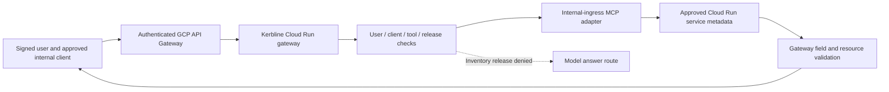
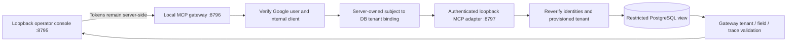

# Kerbline Gateway

**A read-only MCP gateway pilot for controlled access to customer infrastructure and business-system metadata.**

Kerbline verifies caller identities, applies server-owned tool and tenant permissions, reads a restricted data source, and validates an explicit release schema before returning information. Its token-efficiency experiment aggregates synthetic invoice data before inference rather than sending every invoice row to a model.

**Status: engineering pilot, not production-ready.** The repository includes a deployed GCP inventory pilot, a separately tested local PostgreSQL MCP workflow, two operator/customer interfaces, and historical experiments. These have different security boundaries. The local PostgreSQL adapter is **not connected privately to the deployed GCP gateway**.

## Contents

- [Implemented capabilities](#implemented-capabilities)
- [Architecture and trust boundaries](#architecture-and-trust-boundaries)
- [Repository layout](#repository-layout)
- [Start locally](#start-locally)
- [Identity, policy and configuration](#identity-policy-and-configuration)
- [PostgreSQL pilot](#postgresql-pilot)
- [GCP deployment and verification](#gcp-deployment-and-verification)
- [Customer demonstration](#customer-demonstration)
- [Testing](#testing)
- [Token-efficiency evidence](#token-efficiency-evidence)
- [Security boundaries and limitations](#security-boundaries-and-limitations)
- [Troubleshooting](#troubleshooting)
- [Next milestones](#next-milestones)

## Implemented capabilities

| Capability | Current implementation | Scope / limitation |
| --- | --- | --- |
| MCP interface | Initialize, discovery and read-only tool calls; independent SDK verification | Pilot protocol implementation, not a general connector marketplace |
| User identity | Google JWT verification and server-owned subject bindings | Manual configuration; enterprise SSO lifecycle and SCIM are absent |
| Workload identity | Pinned caller identities in the deployed GCP path | Local PostgreSQL uses a separate loopback adapter credential |
| Tool authorization | Roles select allowed tools; request-supplied roles confer no authority | A UI policy draft does not change runtime policy |
| GCP inventory | `cloud_run_inventory` reads explicitly approved Cloud Run resources | Service-level `run.services.get`; no arbitrary project/resource discovery |
| Infrastructure details | Actual resource names, project, region, ingress, revisions and traffic allocation | Timestamped API observations; READY is not an application probe or instance count |
| PostgreSQL inventory | `postgres_api_inventory` reads a dedicated tenant-pinned view | Local signed MCP path only; one provisioned database tenant |
| Field release | Positive field schemas and a second gateway validation | Not a general PII detector or reversible masking vault |
| Execution | Synthetic invoice aggregation and bounded declarative plans | Arbitrary generated JavaScript and business writes disabled |
| Request evidence | Trace ID, hashed verified subject, policy version and released-field names | Local evidence; no immutable retention or SIEM guarantee |
| Token benchmark | Provider-counted row payload versus local aggregate | Synthetic input-token comparison; not verified net financial savings |
| Customer console | Inventory import, draft policies, telemetry and presentation views | Separate installation-level console, not the execution control plane |

## Architecture and trust boundaries

### Deployed GCP inventory pilot



The API Gateway front door is authenticated and public. The adapter uses internal ingress; gateway VPC egress and Private Google Access support the deployed service path. These facts do not imply that every client connection is private or that a VPN to a customer's premises exists.

Inventory queries make **no model request**. The separate synthetic invoice inference experiment used a global Vertex endpoint when the checked Sydney model IDs were unavailable. There is no automatic global fallback and no claim of AU-only inference for that experiment.

### Local PostgreSQL MCP workflow



This is a host-local test topology. The adapter invokes a fixed Docker command to authenticate using a dedicated PostgreSQL login. Its gateway transport credential and database password stay in private local files. Loopback HTTP is not mTLS. Administrative Docker access remains outside the restricted database-role boundary.

The deployed cloud gateway fails closed for this local-loopback PostgreSQL transport. A customer-controlled private route and production adapter identity are still required before connecting the two topologies.

## Repository layout

```text
 gateway_runtime/
   app.py                     Gateway/adapter FastAPI application and MCP routing
   inventory.py               GCP resource allowlist and metadata projection
   postgres_mcp.py            Local signed PostgreSQL MCP contract and adapter
   local_connectors/          Fixed PostgreSQL query and release validation
   operator_console.py        Loopback evidence server and fixed operator actions
   operator.html              Infrastructure, policies, efficiency and evidence UI
   policy.json                Fail-closed sample policy; no configured users
   deploy/                    GCP/local setup, verification and benchmark scripts
   tests/                     Runtime, authorization, release and failure tests
 kerbline_explorer_ui/         Separate inventory/setup/telemetry customer console
 kerbline_telemetry/           Shared metadata-only telemetry support
 phase_b_poc/                 Historical document/PII experiments
 phase_c_poc/                 Historical execution/Host RPC experiments
 Kerbline_*.md                Design, pitch and implementation-history documents
```

Root architecture/product documents describe a **target design** unless explicitly stated otherwise. They are not a checklist of shipped features. Legacy Phase B/C services were not upgraded in cloud by the new gateway pilot; do not deploy them as the current production security boundary.

Machine credentials, local policy bindings, runtime databases, customer observations, logs and generated documents are deliberately excluded from version control. A fresh clone will not include this Mac's pilot configuration or evidence.

## Start locally

### Requirements

- Python 3.12 or 3.13 and `venv` for the gateway and tests.
- Node.js only for JavaScript syntax checks or historical JavaScript components.
- Google Cloud CLI plus an authorized user/project for signed cloud or local-MCP tests.
- Docker Desktop and the existing authorized PostgreSQL test container for the local database workflow.
- Optional MCP Python SDK for independent protocol verification.

Create an isolated environment from the repository root:

```sh
python3 -m venv .venv
source .venv/bin/activate
python -m pip install -r gateway_runtime/requirements.txt
```

Do not rely on globally installed FastAPI/Starlette versions. The gateway requirements pin compatible versions.

### Operator evidence UI

```sh
python gateway_runtime/operator_console.py
```

Open **http://127.0.0.1:8795/**.

The UI reads saved observations from ignored local directories. Opening the page does not query GCP or run inference. On a fresh clone, missing evidence is expected. The refresh buttons execute fixed server-side scripts; they need the corresponding configured identities and running services.

The console binds to loopback, checks Host/Origin, and requires a per-process nonce for actions. Credentials stay server-side. This is a local operator interface, not a hosted enterprise authentication system. Do not expose it directly to the Internet.

### Separate customer inventory and telemetry console

```sh
python kerbline_explorer_ui/server.py
```

The default URL is **http://127.0.0.1:8787/**. An existing local instance can use another configured port. This is a separate application from the operator evidence UI above.

See [customer-console setup](kerbline_explorer_ui/README.md) and [traffic/usage documentation](kerbline_explorer_ui/TELEMETRY.md) for authentication options, persistence, collectors, roles and presentation mode. Its policy editor saves drafts and does not publish gateway policy.

## Identity, policy and configuration

The checked-in `gateway_runtime/policy.json` has no configured user subjects, user audience or adapter URL, and inference is disabled. It intentionally does not grant access out of the box.

The gateway accepts policy via `POLICY_PATH` or `KERBLINE_POLICY_JSON`. Runtime policy owns the allowed subject-to-role/tenant bindings and tool permissions. User input, LLM output, `_meta`, headers claiming a role and requested tenant IDs are not proof of authorization.

A configured operator workflow uses:

1. A signed Google user token with the configured audience and an approved subject binding.
2. An independently verified signed internal-client token for restricted inventory release.
3. A pinned workload caller identity in the deployed GCP service path, or a private host-local adapter credential for the PostgreSQL pilot.
4. A dedicated least-privilege database login for the PostgreSQL view.

Production credentials should come from the customer's managed identity and secret-management systems. The pilot uses `.local/` files with mode `0600`; never commit them or copy them into screenshots, tickets or model prompts.

## PostgreSQL pilot

The existing test installation uses database `relayops` in container `relayops-postgres`.

The dedicated `kerbline_inventory_reader` login has no superuser, role creation, database creation, replication or RLS-bypass attributes. The authorized view is `kerbline_inventory.approved_apis`, pinned in SQL to one provisioned tenant. Application base tables and credential tables are not granted to the reader.

Released fields:

```text
id, tenant_id, name, base_path, enabled, auth_type
```

Excluded fields include JWT secrets, passwords, request headers, upstream URLs and unrestricted JSON configuration. Text fields are bounded to 256 characters. The fixed query releases at most 50 rows, detects truncation, applies statement and lock timeouts, and validates tenant/field/role context again before release.

The current MCP tool accepts only an optional `destination: internal_app`. Requests cannot supply SQL, resource URLs, a tenant override, table names or a custom field list. The model answer route rejects this tool.

### Setup is installation-specific

`gateway_runtime/deploy/setup_local_postgres.py` is the **one-time additive setup for the existing test installation**. It creates a role/schema/view and a generated private credential file. It contains a pinned test tenant; inspect and adapt it before using another installation. It refuses to overwrite an existing credential file. It does not create or seed a new PostgreSQL database.

The configured signed pilot also needs these ignored files:

| File | Purpose |
| --- | --- |
| `.local/postgres-reader.json` | Dedicated reader password and provisioned database tenant |
| `.local/postgres-mcp-policy.json` | Verified user/client configuration and server-owned database tenant bindings |
| `.local/postgres-adapter-key` | Private local gateway-to-adapter transport credential |

These files must be provisioned for each installation; they are not distributed with this source. The signed policy follows the gateway policy shape and additionally defines `postgres.transport: local-loopback` and `postgres.subjects[verified_subject]` with `tool: postgres_api_inventory` and the provisioned `tenantId`. Its role must permit that tool and inference must remain disabled. Never authorize a subject or tenant based on an unverified JWT decode.

Once configured, run these commands in **separate terminals** from `gateway_runtime`, with the virtual environment activated:

```sh
POLICY_PATH="$PWD/../.local/postgres-mcp-policy.json" python -m uvicorn app:app --host 127.0.0.1 --port 8796 --no-access-log
```

```sh
python -m uvicorn postgres_mcp:adapter --host 127.0.0.1 --port 8797 --no-access-log
```

```sh
python operator_console.py
```

In the UI, choose **Refresh database inventory**. The response includes the verified user subject hash, one trace across the gateway/adapter, policy version and release fields. Another tenant requires its own provisioned database scope; this is not an unrestricted multi-tenant database broker.

See [runtime setup and boundaries](gateway_runtime/README.md) for the detailed workflow.

## GCP deployment and verification

Scripts under `gateway_runtime/deploy/` target the original authorized test project and known pilot resource names. **They are not generic provisioning templates.** Inspect project, region, service names, IAM assumptions and model configuration before execution in any other account. Some create or update billable resources.

The cloud installation uses an authenticated API Gateway, separate Cloud Run gateway/adapter services, internal adapter ingress, explicit resource authorization and service-level metadata-read IAM. Cloud inventory releases no environment variables, secret values or container configuration.

Local cloud evidence is generated into ignored directories such as `tmp/system-design/` and `tmp/inventory/`. Files referenced by the operator scripts include deployment records and local policy environment state; these must be generated or provisioned for an installation. Absence of these files in a fresh checkout is intentional.

Selected tools:

| Script | Action |
| --- | --- |
| `cloud_pilot.py` | Original installation-specific cloud provisioning/deployment |
| `deploy_inventory.py` | Install the approved-resource inventory policy in that pilot |
| `capture_deployment.py` | Record deployed revisions and image metadata |
| `inventory_client.py` | Read approved GCP inventory using signed identities |
| `verify_inventory.py` | Live cloud authorization/release tests; no model call |
| `verify_inventory_sdk.py` | Independent MCP SDK check against the cloud inventory tool |
| `verify_cloud.py` | Separate synthetic workflow checks, including a bounded model call |
| `token_benchmark.py` | Synthetic provider input-token comparison |

Do not present a health endpoint, imported metadata file or deployment manifest as proof of end-to-end network isolation, current application health or regulatory compliance.

## Customer demonstration

1. Open the operator UI and refresh approved GCP inventory. Confirm the fetch timestamp advances and inspect actual service/resource names, region, ingress and traffic-serving revisions.
2. Select request evidence to show the trace, policy and released fields. Distinguish historical local-account attribution from the verified-subject hash emitted by the signed PostgreSQL workflow.
3. Run the unapproved-resource demonstration. An expected HTTP 403 proves rejection of that specific request; it is not evidence of universal attack prevention.
4. Refresh PostgreSQL inventory through the signed local MCP path. Inspect its tenant scope and six-field output. State explicitly that this path is local rather than privately connected to GCP.
5. Show token efficiency separately. Explain the synthetic workload, measurement exclusions and lack of reconciled AUD savings.
6. Show recorded tests and outstanding integrations. Observations are snapshots, not continuous monitoring or immutable audit evidence.

Do not run the synthetic verification button when a no-inference demonstration is required; it makes a bounded model call. Inventory refreshes do not.

## Testing

### Local tests without live cloud/database access

```sh
python -m unittest discover -s gateway_runtime/tests -v
```

The runtime suite was last verified with **77 passing tests** during this pilot. It covers identity/role checks, argument validation, resource/tenant isolation, release schemas, model-route denial, failure preservation and historical safety regressions. This number is recorded history, not a guarantee that tests were rerun on every checkout.

For the separate customer console and producer integration tests:

```sh
python -m pip install -r kerbline_explorer_ui/tests/requirements.txt
python -m unittest discover -s kerbline_explorer_ui/tests -v
node --check kerbline_explorer_ui/app.js
node --check kerbline_explorer_ui/traffic.js
```

### Live, configured integration tests

```sh
python gateway_runtime/deploy/verify_local_postgres.py
python gateway_runtime/deploy/verify_postgres_mcp.py
python gateway_runtime/deploy/verify_inventory.py
```

Live MCP SDK scripts need the separate `mcp`, `httpx2` and `certifi` Python packages, which are not required by the gateway server itself. Install compatible versions in a separate test environment; they are not part of a locked production dependency set here.

**Important test effects:** `verify_postgres_mcp.py` briefly pauses the authorized PostgreSQL test container to exercise a real outage, restores it in a `finally` block and confirms recovery. Run it only in the intended test environment. `verify_local_postgres.py` uses denied no-op insert/update probes with `WHERE false`; no business rows are changed. The synthetic cloud verification makes a model call.

Recorded pilot results include 14 cloud-inventory checks, 10 local database permission checks, 14 signed local PostgreSQL MCP checks, independent SDK tests and desktop/mobile browser tests. Expired-identity and cross-tenant failure injection are local tests; they are not a claim of replaying a genuine expired provider token against every deployed endpoint.

## Token-efficiency evidence

The synthetic invoice experiment measured these equivalent-question input payloads using the provider's token-counting API:

| Input representation | Tokens |
| --- | ---: |
| Individual synthetic invoice rows | 1,839 |
| Locally calculated aggregate | 46 |
| Input-payload reduction | 97.5% |

This excludes output tokens, planning, infrastructure, gateway operation and net AUD costs. It does not establish production savings, equivalent answer quality for arbitrary tasks, or a 97.5% reduction in a customer's total bill. Inventory workflows use zero model tokens because they do not invoke inference.

## Security boundaries and limitations

See [SECURITY.md](SECURITY.md) for handling credentials and reporting security concerns.

Implemented controls include signed identity checks, tool/tenant allowlists, restricted database permissions, bounded fixed queries, positive response schemas, internal-only inventory release and metadata-focused trace records.

The following remain incomplete or outside this pilot:

- Private connectivity between the deployed GCP gateway and this Mac's PostgreSQL adapter.
- Enterprise SSO onboarding/SCIM, general connector onboarding and customer credential lifecycle management.
- General-purpose PII/DLP detection, reversible token vault and validated anonymization.
- Hardened arbitrary generated-code execution, business writes, durable approvals and ERP reconciliation.
- Immutable audit retention, complete SIEM integration, comprehensive penetration testing and compliance certification.
- Reconciled billing, measured net financial savings, production HA/DR and continuous application monitoring.

Encryption in transit does not prevent a permitted model provider from processing released content. Masking is not a guarantee of anonymization. An external AI chat application may already receive whatever the user types before Kerbline sees a tool request. This gateway controls the paths that actually traverse it, not all activity in external AI products.

## Troubleshooting

| Symptom | Check |
| --- | --- |
| UI shows no observations | Expected on a fresh clone; configure the environment and run the appropriate refresh |
| Refresh returns 401/403 | Verify Google login, audience, approved subject/client and role/tenant binding; never bypass the check |
| PostgreSQL refresh fails | Confirm Docker, the test container, ports 8796/8797, private file permissions and the restricted view |
| Old observations remain visible | Read the failure warning and last successful timestamp; do not treat saved state as current health |
| Cloud PostgreSQL request returns 503 | Expected until an approved private customer transport is implemented |
| Synthetic inference unavailable | Check the explicit model policy/project; do not add an implicit regional fallback |
| FastAPI/Starlette import or test error | Use an isolated virtual environment with the pinned gateway requirements |
| Draft policy changes have no runtime effect | Expected: console draft editing and deployed execution policy are separate |

## Next milestones

1. Choose and implement a customer-controlled private network route, or host the test adapter inside the GCP VPC.
2. Replace the local adapter credential/file provisioning with managed workload identity and secret management.
3. Extend verified user-to-tenant bindings to the customer's identity lifecycle and independently provisioned database scopes.
4. Add durable, redacted decision auditing and failure/recovery evidence appropriate to production operation.
5. Evaluate one policy-approved aggregate model answer and measure tokens, answer quality and total operating cost against a comparable baseline.

Until those checks pass, present Kerbline as a demonstrated read-only engineering pilot with explicit production gates.
